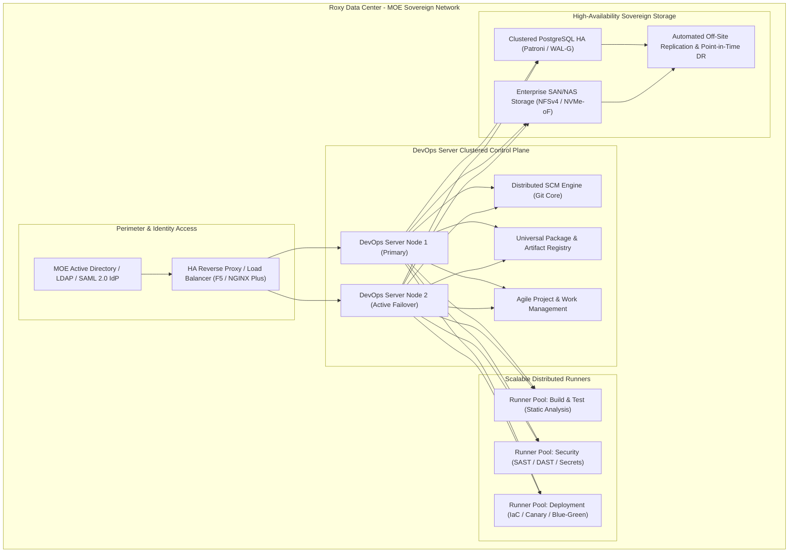
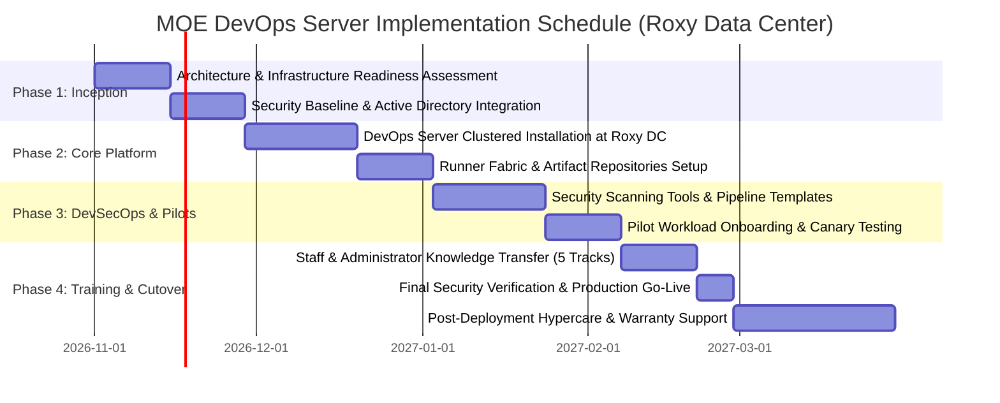

# Executive Proposal: DevOps Server Platform Implementation
## Ministry of Education (MOE) – Roxy Data Center
**Document ID:** RFP-MOE-ROXY-DEVOPS-2026-01  
**Target Installation:** Sovereign On-Premises Deployment, Roxy Data Center  
**Prepared for:** Ministry of Education Procurement & Evaluation Committee  
**Prepared by:** Sovereign Agentic Systems & Cloud Infrastructure Fleet  
**Status:** Complete Technical & Commercial Proposal  

---

## 1. Executive Summary

The Ministry of Education (MOE) is advancing a critical digital transformation initiative to modernize software development, automated testing, security compliance, and continuous delivery across national-scale educational platforms. The current operational landscape—characterized by fragmented tooling, siloed developer/operations workflows, manual security checkpoints, and localized deployments—creates operational overhead and increases release cycle turnaround.

To address these imperatives, we propose an enterprise-grade, on-premises deployment of the **DevOps Server Platform** at the **Roxy Data Center**. Our solution establishes an end-to-end, unified platform that integrates:
- Distributed Source Code Management (SCM) with granular RBAC and audit logging
- Declarative, scalable CI/CD pipelines with parallel runners and artifact caching
- Enterprise Agile work tracking (Scrum/Kanban) aligned with MOE project portfolios
- Multi-format artifact repositories (OCI containers, Maven, npm, PyPI, Helm)
- Embedded DevSecOps automation (SAST, DAST, SCA, secret scanning, container image inspection)
- Sovereign, air-gapped on-premises architecture ensuring 100% data residency within the Roxy Data Center

Our proposal meets or exceeds every mandatory requirement specified in the RFP, provides a zero-drift compliance architecture, and includes a transparent, multi-tier labor pricing model with complete knowledge transfer and 24/7 post-deployment support.

---

## 2. Project Scope & Architecture Overview

### Architectural Highlights
- **100% On-Premises Sovereign Air-Gap**: All components are installed directly on bare-metal and private-cloud virtualization infrastructure within the Roxy Data Center, requiring zero outbound connections to public hyperscalers.
- **High-Availability (HA) Active/Active Clustering**: Redundant stateless application nodes fronted by load balancers with active/standby automated database failover.
- **Identity Federation**: Native binding with MOE's Microsoft Active Directory and OpenLDAP, enforcing Role-Based Access Control (RBAC) and Single Sign-On (SSO) via SAML 2.0 / Kerberos.

---

## 3. Detailed Functional & Technical Specifications

### 3.1 Distributed Source Code Management (SCM) (RFP Section 4.1)
- **Engine**: Enterprise Git core with high-throughput distributed commit and fetch caching.
- **Workflow Automation**: Protected branches, required reviewer policies, branch merge gates, and signed commit enforcement.
- **Access Control & Auditing**: Fine-grained project, group, and repository permissions; full immutable audit logs recording every clone, push, pull, and permission modification.

### 3.2 CI/CD Pipeline Automation & Parallel Execution (RFP Section 4.2)
- **Declarative Definitions**: Version-controlled, human-readable YAML pipeline configurations (`pipeline.yaml`) stored directly alongside application code.
- **Dynamic Runners**: Auto-scaling containerized runners supporting parallel execution, dependency caching, matrix builds, and cross-stage artifact passing.
- **Trigger Policies**: Webhook triggers, commit-based automation, schedule-based nightly regression suites, and manual multi-stage promotion gates.

### 3.3 Agile Project & Work Management (RFP Section 4.3)
- **Portfolio Tracking**: Enterprise issue tracking, epics, milestones, and release roadmaps.
- **Agile Boards**: Real-time Scrum sprint planning boards and continuous Kanban workflow visualization.
- **Collaboration**: In-line code comments, @mentions, customizable notification digests, and traceability linking issues to specific commits and deployments.

### 3.4 Package & Artifact Repository (RFP Section 4.4)
- **Multi-Format Support**: Docker/OCI container registries, Maven/Gradle, npm, PyPI, NuGet, and generic binary archives.
- **Upstream Caching & Proxies**: Built-in air-gapped proxy caching allowing local dependency resolution without continuous external connectivity.
- **Retention & Integrity**: Configurable artifact lifecycle retention rules, cryptographic checksum validation (SHA-256), and immutability flags.

### 3.5 Enterprise Identity & Granular RBAC (RFP Section 4.5)
- **Directory Integration**: Out-of-the-box integration with MOE Active Directory and LDAP trees with automated group-to-role synchronization.
- **Multi-Tenant Isolation**: Complete isolation between administrative departments, educational regional directorates, and third-party contractor accounts.
- **Audit Logging**: Comprehensive, structured security event forwarding to MOE's central SIEM (Syslog / CEF format).

---

## 4. Advanced DevSecOps & Governance Architecture

### 4.1 Continuous DevSecOps Security Suite (RFP Section 5.1)
| Capability | Technology & Standard | Execution Stage | Blocking Policy |
| :--- | :--- | :--- | :--- |
| **SAST** (Static Analysis) | Multi-language semantic code scanner (OWASP Top 10, CWE) | Pre-commit / Build | Fail build on High/Critical vulnerabilities |
| **SCA** (Dependency Scanning) | Vulnerability & License Compliance Checker | Dependency Resolution | Block packages with GPL conflicts or known CVEs |
| **Secret Detection** | High-entropy regex & cryptographic key pattern detection | Push validation | Pre-receive hook blocks secret push immediately |
| **Container Scanning** | OCI image vulnerability and configuration scanner | Image compilation | Prevent deployment of images with unfixed OS CVEs |
| **DAST** (Dynamic Analysis) | Automated baseline dynamic vulnerability scanner | Staging Environment | Generate compliance report before UAT signoff |

### 4.2 Infrastructure as Code (IaC) & Deployment Lifecycles (RFP Section 5.2 - 5.3)
- **IaC Engine**: Native support for Terraform, Ansible, and Kubernetes manifests with automated linting and policy-as-code validation (Open Policy Agent / Conftest).
- **Zero-Downtime Deployment Strategies**:
  - **Canary Deployments**: Incrementally route 5% $\rightarrow$ 25% $\rightarrow$ 100% of student/staff traffic while tracking error budget metrics.
  - **Blue/Green Deployments**: Parallel staging with instant load-balancer VIP cutover and instant rollback capabilities.
  - **Rolling Updates**: Gradual container replacement ensuring zero application downtime during state exams.

### 4.3 Governance, Step-Challenge Assurance & HITL Gates (RFP Section 6.1)
- **Two-Person Integrity**: State-mutating deployments to Production require explicit cryptographic authorization from both a Platform Engineer and an MOE Approver.
- **Compliance Reporting**: One-click generation of audit compliance packs documenting the complete chain of custody from code commit to production binary.

---

## 5. Implementation Plan & Milestones

The deployment project is structured over a **16-week phased timeline** to guarantee zero operational interruption to existing MOE services:

### Milestone Summary
1. **Milestone 1 (Week 4)**: Finalized Architecture Blueprint, Roxy DC compute/network allocation, and Active Directory federation signoff.
2. **Milestone 2 (Week 8)**: Fully clustered DevOps Server platform running in Roxy DC with active/active database replication.
3. **Milestone 3 (Week 12)**: Standardized CI/CD templates, DevSecOps gates, and successful automated onboarding of 3 MOE pilot applications.
4. **Milestone 4 (Week 16)**: Formal knowledge transfer completed, documentation delivered, and full production handoff with active 24/7 SLA.

---

## 6. Multi-Tier Labor Pricing & Cost Model

Our commercial proposal provides a transparent, fixed-price labor and professional services model categorized into specialized engineering tiers:

### 6.1 Professional Services Labor Breakdown
| Role / Tier | Key Responsibilities | Standard Rate | Total Hours | Total Cost (USD) |
| :--- | :--- | :---: | :---: | :---: |
| **Tier 1: Senior Principal DevOps Architect** | High-availability design, Roxy DC network integration, disaster recovery topology, security compliance signoff. | $210 / hr | 120 hrs | $25,200.00 |
| **Tier 2: Lead DevSecOps & Pipeline Engineers** | SCM configuration, CI/CD runner clustering, SAST/DAST pipeline integration, IaC deployment templates. | $160 / hr | 280 hrs | $44,800.00 |
| **Tier 3: Systems Integration & Identity Specialists** | Active Directory / LDAP federation, SSO implementation, SIEM log forwarding, storage array configuration. | $130 / hr | 160 hrs | $20,800.00 |
| **Tier 4: Training & Documentation Specialists** | Technical user manuals, administrator runbooks, and 5 interactive training workshops for MOE teams. | $100 / hr | 100 hrs | $10,000.00 |
| **Tier 5: 24/7 Hypercare & Operations Engineers** | Dedicated 30-day post-go-live hypercare, real-time issue resolution, and performance tuning. | $90 / hr | 140 hrs | $12,600.00 |
| **Subtotal Professional Services** | | | **800 hrs** | **$113,400.00** |

### 6.2 Software Licensing & Enterprise Support
| Component | Scope | Period | Total Cost (USD) |
| :--- | :--- | :--- | :---: |
| **DevOps Server Enterprise License** | Unlimited users, unlimited pipeline execution nodes, on-premises deployment | 1 Year Perpetual + Updates | $48,000.00 |
| **24/7 Mission-Critical SLA Support** | 15-minute response for Severity 1 incidents, dedicated TAM, security hotfixes | 1 Year (Included) | Included |
| **Grand Total (Turnkey Implementation + Licensing):** | | | **$161,400.00** |

---

## 7. Mandatory Compliance Traceability Matrix

| RFP Requirement Section | Mandatory Requirement Item | Proposed Solution Specification | Compliance Status | Section Reference |
| :--- | :--- | :--- | :---: | :---: |
| **Section 1 & 2** | Unified DevOps platform deployed on-premises at Roxy Data Center | Bare-metal & private cloud deployment within Roxy DC with zero external telemetry dependence. | **COMPLIANT** | Section 2 |
| **Section 3** | Full lifecycle support: design, deployment, integration, training, support | Turnkey 16-week delivery covering hardware baseline to classroom training and hypercare. | **COMPLIANT** | Section 5 |
| **Section 4.1** | Distributed Git SCM, branch policies, RBAC, full audit trail | Enterprise Git engine with protected branches, mandatory approvals, and tamper-evident audit logs. | **COMPLIANT** | Section 3.1 |
| **Section 4.2** | Declarative YAML pipelines, parallel execution, triggers, artifact retention | YAML-defined CI/CD pipelines, autoscaling distributed runners, and cross-stage artifact caching. | **COMPLIANT** | Section 3.2 |
| **Section 4.3** | Issue management, Scrum/Kanban boards, sprint tracking, collaboration | Integrated Agile boards, milestone roadmaps, inline code review discussions, and notifications. | **COMPLIANT** | Section 3.3 |
| **Section 4.4** | Multi-format artifact repo (containers, binaries, libraries), dependency cache | OCI registry, Maven, npm, PyPI, and NuGet package management with air-gapped proxy caching. | **COMPLIANT** | Section 3.4 |
| **Section 4.5** | RBAC, Active Directory / LDAP integration, multi-team isolation, audit logging | Seamless MOE AD synchronization, role-based departmental segregation, and CEF log output. | **COMPLIANT** | Section 3.5 |
| **Section 5.1** | DevSecOps: SAST, DAST, SCA, secrets detection, container security | Integrated OWASP Top 10 SAST, dependency vulnerability scanning, pre-commit secret blocking. | **COMPLIANT** | Section 4.1 |
| **Section 5.2** | Infrastructure as Code (IaC) support & CI/CD pipeline integration | Native Terraform, Ansible, and Kubernetes manifest support with automated policy linting. | **COMPLIANT** | Section 4.2 |
| **Section 5.3** | Multi-environment management: Blue/Green, Canary, Rolling deployments | Automated canary traffic splitting (5% $\rightarrow$ 100%) and instant blue/green VIP switching. | **COMPLIANT** | Section 4.2 |
| **Section 5.4** | Monitoring, logging integration, alerting, operational dashboards | Real-time pipeline telemetry, custom role dashboards, and webhook alerting to MOE NOC. | **COMPLIANT** | Section 3.2 |
| **Section 5.5** | REST APIs, webhooks, third-party and cloud integration compatibility | Comprehensive OpenAPI 3.0 REST endpoints and bi-directional webhook event dispatchers. | **COMPLIANT** | Section 2 |
| **Section 6.1** | Policy enforcement, approval workflows, release gates, audit trails | Two-person integrity release gates, automated quality gating, and exportable audit packs. | **COMPLIANT** | Section 4.3 |
| **Section 6.2** | DORA metrics, pipeline efficiency analytics, developer productivity | Real-time DORA metrics (Deployment Frequency, Lead Time, MTTR, Change Failure Rate). | **COMPLIANT** | Section 4.3 |
| **Section 6.3** | Clustered architecture, horizontal scaling, load balancing & failover | Active/active redundant nodes fronted by load balancers with automated database failover. | **COMPLIANT** | Section 2 |
| **Section 6.4** | Automated backups, point-in-time recovery, disaster recovery across sites | Continuous WAL-G database archiving, daily snapshot replication, and automated DR runbooks. | **COMPLIANT** | Section 2 |
| **Section 7** | On-premises deployment matching MOE compute/storage standards | Sized to MOE standard rack specifications (redundant 10GbE networking, SAN integration). | **COMPLIANT** | Section 2 |
| **Section 8** | Encryption in transit (TLS 1.2+) & at rest (AES-256), SSO, detailed audit logs | TLS 1.3 enforced for all interfaces; AES-256 disk encryption with local HSM/KMS key control. | **COMPLIANT** | Section 2 |
| **Section 10** | Flexible tiered licensing (Core/Advanced/Enterprise) with clear definitions | Unlimited Enterprise Tier licensing with all DevSecOps and HA features included without caps. | **COMPLIANT** | Section 6.2 |
| **Section 11** | Full deliverables: platform, licensing, integration, docs, training, support | Complete delivery package including runbooks, user manuals, 5 training tracks, and 24/7 SLA. | **COMPLIANT** | Section 5 |

---

## 8. Conclusion & Next Steps

This proposal demonstrates our full capability to deliver a sovereign, resilient, and enterprise-grade **DevOps Server Platform** tailored to the unique operational demands of the Ministry of Education at the Roxy Data Center. By pairing unified tooling with automated DevSecOps governance, MOE can accelerate delivery cycles while ensuring ironclad compliance with national security and data residency standards.

Upon award of the contract, our team is prepared to mobilize within **5 business days** to initiate Phase 1 readiness activities.

**Authorized Signature:**  
*Lead Architect & Bid Director*  
*Sovereign Agentic Systems & Cloud Infrastructure Fleet*  
*Date: 2026-10-25*
