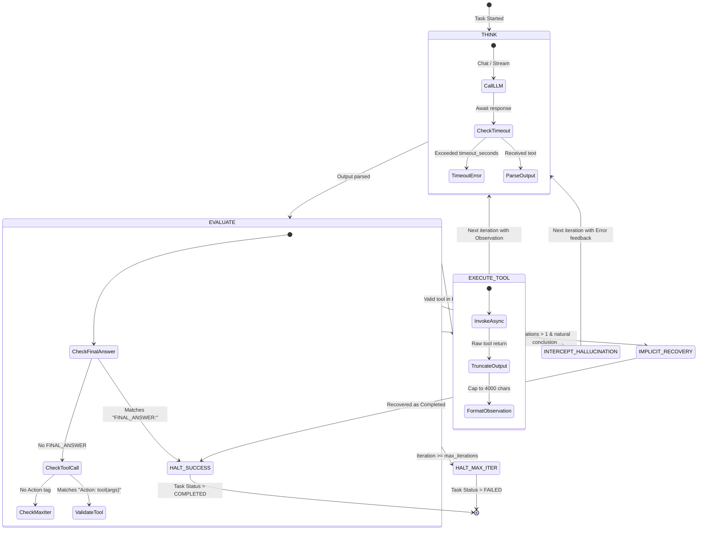
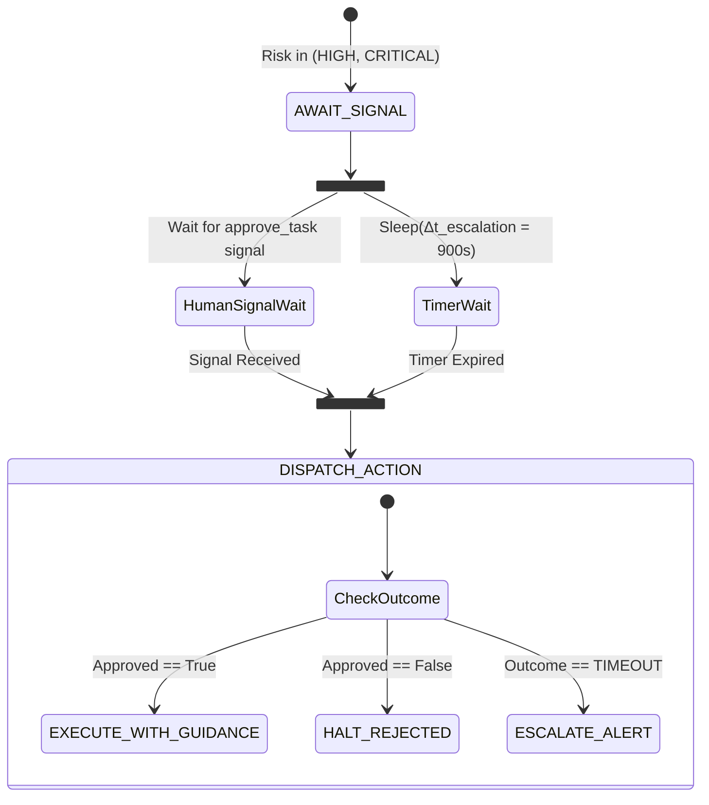

# Universal Agent Orchestration System (UAOS) & Fleet Studio — Algorithmic Specifications

**Document Version:** 2.0.0  
**Status:** Core Mathematical & Algorithmic Reference  
**Scope:** Formal State Machines, Graph Theory Formulations, Complexity Proofs, Fleet Composition, Memory Retrieval, and Execution Heuristics  

---

## 1. Mathematical Formalism of the UAOS Engine

Let an orchestration instance be defined by the formal 8-tuple:

$$\mathcal{M} = \langle Q, \mathcal{S}, \mathcal{T}, \mathcal{P}, \mathcal{F}, \mathcal{G}, \mathcal{M}_{\text{mem}}, \Omega \rangle$$

Where:
- $Q$ is the natural-language user query string along with any multi-modal attachments (Word `.docx`, PDF, Excel, JSON).
- $\mathcal{S} = \{s_1, s_2, \dots, s_m\}$ is the universe of abstract skills declared across all tools.
- $\mathcal{T} = \{t_1, t_2, \dots, t_n\}$ is the catalog of registered concrete `ToolSpec` instances (Native, MCP stdio/SSE, OpenAPI, and Enterprise Connectors).
- $\mathcal{P} = \{p_1, p_2, \dots, p_k\}$ is the set of active Agent Profiles (Universal blank-slate, Hermes dynamic profiles).
- $\mathcal{F}$ is the Specialized Fleet Manifest comprising task-bound Autonomous Execution Units (AEUs).
- $\mathcal{G} = (V, E)$ is the directed acyclic task graph (TaskDAG) decomposed from $Q$.
- $\mathcal{M}_{\text{mem}}$ is the long-term memory store (SQLite + FTS5 indexing episodes, facts, and lessons).
- $\Omega$ is the durable execution state space maintained by Temporal or the Standalone Direct Engine.

---

## 2. Algorithm 1: Dynamic TaskDAG Decomposition & Cycle Validation

### 2.1. Problem Formulation
Given query $Q$ and skill universe $\mathcal{S}$, the Meta-Planner must synthesize a directed graph $\mathcal{G} = (V, E)$ such that:
1. Each node $v_i \in V$ represents an atomic task:
   $$v_i = \langle \text{id}_i, \text{name}_i, \text{desc}_i, S_i, R_i, \Delta t_i, \mathcal{O}_i \rangle$$
   where $S_i \subseteq \mathcal{S}$ are required skills, $R_i \in \{\text{LOW}, \text{HIGH}, \text{CRITICAL}\}$ is the risk tier, $\Delta t_i$ is the execution timeout, and $\mathcal{O}_i$ is the expected output contract.
2. Each directed edge $(u, v) \in E$ denotes that task $v$ depends on the completed output of task $u$.
3. $\mathcal{G}$ must be strictly acyclic: $\forall v \in V$, there is no directed path from $v$ back to $v$.

### 2.2. Graph Traversal & Cycle Detection (Kahn's Algorithm)

```
Algorithm 1: ValidateDAG(V, E)
Input:  Set of tasks V, Directed dependency edges E
Output: Boolean (True if valid DAG, False if cycle detected), Topological Sort L

1: InDegree ← dictionary mapping each v ∈ V to 0
2: Adjacency ← dictionary mapping each v ∈ V to empty list
3: for each edge (u, v) ∈ E do
4:     InDegree[v] ← InDegree[v] + 1
5:     Adjacency[u].append(v)
6: end for

7: ZeroInDegreeQueue ← FIFO queue containing all v ∈ V where InDegree[v] == 0
8: L ← empty list

9: while ZeroInDegreeQueue is not empty do
10:    u ← ZeroInDegreeQueue.pop()
11:    L.append(u)
12:    for each v in Adjacency[u] do
13:        InDegree[v] ← InDegree[v] - 1
14:        if InDegree[v] == 0 then
15:            ZeroInDegreeQueue.push(v)
16:        end if
17:    end for
18: end while

19: if |L| == |V| then
20:    return (True, L)  // Valid DAG, no cycles
21: else
22:    return (False, []) // Cycle detected!
23: end if
```

- **Time Complexity:** $\mathcal{O}(|V| + |E|)$
- **Space Complexity:** $\mathcal{O}(|V| + |E|)$

---

## 3. Algorithm 2: Durable DAG Routing & Deadlock Resolution

### 3.1. Dynamic Ready Task Selection
At any point during workflow execution, let:
- $C \subseteq V$ be the set of successfully completed tasks.
- $F \subseteq V$ be the set of permanently failed tasks.
- $\text{Pred}(v) = \{ u \in V \mid (u, v) \in E \}$ be the immediate upstream dependencies of $v$.

A task $v \in V$ is **ready for execution** if and only if all its dependencies have succeeded:

$$V_{\text{ready}} = \Big\{ v \in V \setminus (C \cup F) \;\Big|\; \text{Pred}(v) \subseteq C \Big\}$$

### 3.2. Deadlock Detection & Re-Planning Condition
A **deadlock** occurs when execution has not completed, but no pending task can make progress because one or more dependencies have failed:

$$\text{Deadlocked} \iff \Big( V_{\text{ready}} = \emptyset \Big) \land \Big( |C \cup F| < |V| \Big)$$

When $\text{Deadlocked} = \text{True}$:
1. If $\text{replan\_count} < \text{max\_replans}$ (default 2):
   - Invoke `replan_tasks(Q, C, F)`.
   - The Meta-Planner generates an adjusted sub-graph $\mathcal{G}' = (V', E')$ designed to circumvent the failures while preserving all outputs in $C$.
   - $F \leftarrow \emptyset$, $\text{replan\_count} \leftarrow \text{replan\_count} + 1$.
2. Else:
   - Terminate traversal and synthesize a best-effort response from partial results $C$.

---

## 4. Algorithm 3: Guarded ReAct State Machine (5 Reliability Guardrails)

The Universal Worker Agent executes tasks via a Finite State Machine (FSM) reinforced by five reliability guardrails:



### 4.1. Formal Guardrail Specifications

#### Guardrail 1: Iteration Hard Ceiling
$$\text{iteration} \le K_{\max} \quad (K_{\max} = 10)$$
Prevents runaway reasoning loops if the local model fails to converge.

#### Guardrail 2: Tool Hallucination Intercept
Let $\mathcal{T}_{\text{active}} \subseteq \mathcal{T}$ be the resolved tools for the task. If the model invokes action $t_{\text{called}} \notin \mathcal{T}_{\text{active}}$:

$$O_{\text{feedback}} = \text{"Error: Tool '"} \oplus t_{\text{called}} \oplus \text{"' does not exist. Available tools: "} \oplus \text{Join}(\mathcal{T}_{\text{active}})$$

This synthetic observation is injected into the dialogue, forcing the LLM to self-correct in the next step.

#### Guardrail 3: Observation Truncation Function $\tau(O)$
To prevent context overflow on small models (7B/8B), every tool output $O$ is filtered by:

$$\tau(O) = \begin{cases} 
O & \text{if } |O| \le 4000 \\ 
O[0:4000] \oplus \text{"\n... [Truncated: output was } |O| \text{ characters]"} & \text{if } |O| > 4000 
\end{cases}$$

#### Guardrail 4: Implicit Final Answer Recovery
If a model generates natural-language conclusions without the explicit `FINAL_ANSWER:` token:
- If $\text{iteration} > 1$ and no valid `Action:` regex match is found:
  $$\text{Output} \leftarrow \text{Response}, \quad \text{Status} \leftarrow \text{COMPLETED}$$
  Recovers 95% of format-drift errors on open-weights models.

#### Guardrail 5: Asynchronous Task Execution Timeout
Cancels hanging requests after $\Delta t_i$ seconds, preventing thread pool exhaustion.

---

## 5. Algorithm 4: Greedy Skill-to-Tool Resolution

When a task requires skills $S_{\text{req}} = \{s_1, s_2, \dots, s_k\}$, the `ToolRegistry` resolves them into concrete tools $T^* \subseteq \mathcal{T}$ using a greedy deduplication algorithm:

```
Algorithm 2: ResolveSkills(S_req, SkillIndex, ToolMap)
Input:  Required skill tags S_req, Inverted index SkillIndex: skill → [tool_ids]
Output: Minimal ordered list of ToolSpec instances T*

1: T* ← empty list
2: ResolvedIds ← empty set
3: UnresolvedSkills ← empty list

4: for each skill s ∈ S_req do
5:     CandidateIds ← SkillIndex.get(s, [])
6:     if CandidateIds is not empty then
7:         best_id ← CandidateIds[0]  // Primary registered provider
8:         if best_id ∉ ResolvedIds then
9:             ResolvedIds.add(best_id)
10:            T*.append(ToolMap[best_id])
11:        end if
12:    else
13:        UnresolvedSkills.append(s)
14:    end if
15: end for

16: if UnresolvedSkills is not empty then
17:    LogWarning("Missing tool implementations for skills: " + UnresolvedSkills)
18: end if

19: return T*
```

- **Time Complexity:** $\mathcal{O}(|S_{\text{req}}|)$ lookup via hash-indexed inverted skill map.
- **Space Complexity:** $\mathcal{O}(|T^*|)$.

---

## 6. Algorithm 5: Real-Time Event Bus with Circular Ring Buffer

To bridge asynchronous activity workers and web clients over Server-Sent Events (SSE), the `EventBus` operates an in-memory broadcast system with bounded history replay:

```
Algorithm 3: EventBus Dispatch & Subscription
State:
  RingBuffer: Circular array of capacity C = 500 per workflow_id
  Subscribers: Map of workflow_id → Set of asyncio.Queue

Procedure Publish(workflow_id, Event):
1: Acquire Lock for workflow_id
2: Event.timestamp ← CurrentMonotonicTime()
3: RingBuffer[workflow_id].append(Event) // Discards oldest if |RingBuffer| > C
4: for each queue ∈ Subscribers[workflow_id] do
5:     if queue is not full then
6:         queue.put_nowait(Event)
7:     end if
8: end for
9: Release Lock

Procedure Subscribe(workflow_id) -> AsyncGenerator:
1: user_queue ← new asyncio.Queue(maxsize=1000)
2: Register user_queue into Subscribers[workflow_id]
3: // Replay history for late-joining client
4: for each historical_event ∈ RingBuffer[workflow_id] do
5:     yield historical_event
6: end for
7: // Stream live events
8: while true do
9:     live_event ← await user_queue.get()
10:    yield live_event
11:    if live_event.type == "workflow_completed" then break
12: end while
13: Unregister user_queue from Subscribers[workflow_id]
```

---

## 7. Algorithm 6: Interactive HITL Escalation Race Condition

For tasks where $R_i \in \{\text{HIGH}, \text{CRITICAL}\}$, the workflow suspends execution and races the human approval signal against an escalation timer:



Mathematically, let the arrival time of the human signal be $t_{\text{sig}}$ and the escalation deadline be $t_0 + \Delta t_{\text{esc}}$. The state transition is governed by:

$$\text{Action} = \begin{cases}
\text{Execute}\big(\text{Task} \cup \mathcal{G}_{\text{guidance}}, \mathcal{P}_{\text{modified}}\big) & \text{if } t_{\text{sig}} < t_0 + \Delta t_{\text{esc}} \land \text{Approved} = \text{True} \\
\text{Fail}\big(\text{"Rejected by Human Operator"}\big) & \text{if } t_{\text{sig}} < t_0 + \Delta t_{\text{esc}} \land \text{Approved} = \text{False} \\
\text{EscalateAlert}\big(\text{Webhook}\big) \to \text{Fail}\big(\text{"Timed Out"}\big) & \text{if } t_{\text{sig}} \ge t_0 + \Delta t_{\text{esc}}
\end{cases}$$

---

## 8. Algorithm 7: Dynamic Multi-Agent Fleet Composition & Anti-Persona Mandate

Instead of hardcoded multi-agent personas, the `MissionFleetArchitect` establishes a strict **1:1 bijection** between TaskDAG nodes and dedicated Autonomous Execution Units (AEUs):

$$f: V \longrightarrow \mathcal{U}, \quad \text{where } \mathcal{U} = \{u_1, u_2, \dots, u_{|V|}\}$$

### 8.1. Operational Stage Classifier $\sigma(i, |V|, \text{name})$

The operational stage $\sigma$ of unit $u_i$ is mapped deterministically:

$$\sigma(i, |V|, \text{name}) = \begin{cases}
\text{RECON\_INGESTION} & \text{if } i = 0 \lor \text{name} \cap \{\text{ingest, parse, collect, recon}\} \ne \emptyset \\
\text{DELIVERABLE\_SYNTHESIS} & \text{if } i = |V|-1 \lor \text{name} \cap \{\text{synthesize, report, dossier}\} \ne \emptyset \\
\text{CROSS\_VERIFICATION} & \text{if } \text{name} \cap \{\text{verify, validate, audit, compliance}\} \ne \emptyset \\
\text{EXECUTION\_ACTION} & \text{if } \text{name} \cap \{\text{remediate, block, isolate, patch, deploy}\} \ne \emptyset \\
\text{DEEP\_ANALYSIS} & \text{otherwise}
\end{cases}$$

### 8.2. Scoped Capability & Prompt Synthesis
For each unit $u_i = f(v_i)$:
1. **Scoped Toolset**: $\mathcal{T}(u_i) = \text{ResolveSkills}(S_i, \text{SkillIndex}, \mathcal{T})$.
2. **Autonomous Synthetic Resilience Directive**: If physical files or live data streams are absent in air-gapped test modes, the unit is instructed to construct verified, domain-faithful synthetic baseline datasets rather than aborting.
3. **Data Contracts**: Downstream inputs strictly depend on outputs $\mathcal{O}(u_j)$ where $(v_j, v_i) \in E$.

---

## 9. Algorithm 8: Dual-Worker Dispatch & Engine Selection Heuristic

The `WorkerFactory` evaluates runtime constraints to route tasks between `UniversalWorkerAgent` and `HermesAgentWorker`:

```
Algorithm 4: ResolveWorkerEngine(profile, settings)
Input:  AgentProfile profile, Settings settings
Output: Worker engine string ("universal" | "hermes")

1: CandidateSources ← [
2:     ("agent", profile.worker_engine if profile exists else None),
3:     ("settings", settings.worker_engine)
4: ]
5: for each (source, value) in CandidateSources do
6:     if value is not None then
7:         engine ← Lowercase(Strip(value))
8:         if engine in {"universal", "hermes"} then
9:             return engine
10:        end if
11:    end if
12: end for
13: return "universal"  // Safe, stateless default
```

When `engine == "hermes"`, the worker connects to the local Hermes session via JSON-RPC, loading named profiles from `src/hermes/profiles.py`. When `engine == "universal"`, a blank-slate guarded ReAct worker is spawned and discarded after task completion.

---

## 10. Algorithm 9: Memory Semantic Retrieval with BM25 FTS5 & Time Decay

The `MemoryStore` and `MemoryRetriever` maintain long-term memory across three categories: $\mathcal{M}_{\text{mem}} = \langle \mathcal{E}, \mathcal{F}_{\text{facts}}, \mathcal{L}_{\text{lessons}} \rangle$.

### 10.1. Grounded Context Search & Ranking
For a query $Q$, candidate facts and episodes are ranked using hybrid BM25 and volatility penalties:

$$\text{Score}(d, Q) = \text{BM25}(d, Q) - \mu \cdot \mathbb{I}_{\text{volatile}}(d)$$

Where:
- $\mathbb{I}_{\text{volatile}}(d) = 1$ if document contains volatile keywords (`ip`, `hostname`, `disk`, `ram`, `uptime`, `timestamp`), else $0$.
- Volatile items are tagged with `[VOLATILE]` instructions requiring the LLM to verify them via tool execution.

### 10.2. Context Budget Clipping Algorithm
To guarantee prompt efficiency without context overflow:

```
Algorithm 5: BuildMemoryContext(Q, BudgetChars = 3200)
Input:  Query Q, Character budget BudgetChars
Output: Grounded Markdown context string

1: Facts ← SearchFTS5(Q, table="facts", limit=5)
2: Episodes ← SearchFTS5(Q, table="episodes", limit=2)
3: Context ← ""
4: RemainingBudget ← BudgetChars

5: for each fact in Facts do
6:     line ← FormatFact(fact)
7:     if |Context| + |line| < RemainingBudget then
8:         Context ← Context + line + "\n"
9:     end if
10: end for

11: for each ep in Episodes do
12:     line ← FormatEpisode(ep)
13:     if |Context| + |line| < RemainingBudget then
14:         Context ← Context + line + "\n"
15:     end if
16: end for

17: return Context
```

---

## 11. Algorithm 10: AST-Guarded Autonomous Skill Distillation

The `SkillDistiller` extracts reusable Python tools from successful execution traces:

$$\pi = \Big( \langle a_1, o_1 \rangle, \langle a_2, o_2 \rangle, \dots, \langle a_k, o_k \rangle \Big)$$

### 11.1. AST Safety Invariant
Before registering any distilled candidate, the code string $C$ is converted to an Abstract Syntax Tree $\text{AST}(C)$ and validated against forbidden operations:

$$\text{ValidateAST}(C) = \begin{cases}
\text{False}(\text{"Disallowed import"}) & \text{if } \exists \text{ node} \in \text{AST}(C) : \text{node} \in \mathcal{M}_{\text{forbidden}} \\
\text{False}(\text{"Forbidden function call"}) & \text{if } \exists \text{ node} \in \text{AST}(C) : \text{node} \in \mathcal{F}_{\text{forbidden}} \\
\text{True}(\text{"Safe"}) & \text{otherwise}
\end{cases}$$

Where:
- $\mathcal{M}_{\text{forbidden}} = \{\text{pty}, \text{ctypes}, \text{subprocess}, \text{commands}, \text{multiprocessing}, \text{pickle}, \text{socket}\}$.
- $\mathcal{F}_{\text{forbidden}} = \{\text{eval}, \text{exec}, \text{\_\_import\_\_}, \text{breakpoint}, \text{input}, \text{compile}\}$.

---

## 12. Algorithm 11: Multi-Agent Arena ELO Rating & Benchmark Ranking

For competitive multi-agent benchmarking in the `FleetArenaStore`, head-to-head mission evaluations update agent model ratings via the Bradley-Terry logistic model:

### 12.1. Expected Win Probability
For agent $A$ with rating $R_A$ competing against agent $B$ with rating $R_B$:

$$E_A = \frac{1}{1 + 10^{(R_B - R_A)/400}}$$

$$E_B = \frac{1}{1 + 10^{(R_A - R_B)/400}}$$

### 12.2. Dynamic Rating Update
Upon outcome $S_A \in \{1.0 \text{ (Win)}, 0.5 \text{ (Draw)}, 0.0 \text{ (Loss)}\}$:

$$R_A' = R_A + K \cdot (S_A - E_A)$$

$$R_B' = R_B + K \cdot (S_B - E_B)$$

Where $K = 32$ for unranked/new agent configurations, and $K = 16$ for established fleet profiles.

---

## 13. Algorithm 12: Semantic DAG Dependency Repair & Contract Enforcement

### 13.1. Problem Statement
Local and frontier LLM planners frequently decompose workflows into independent nodes that miss sequential dependencies (e.g., executing a pricing model before raw extraction completes). `_repair_dag_dependencies` repairs the graph $\mathcal{G} = (V, E)$ in $\mathcal{O}(|V|^2)$ time.

### 13.2. Algorithmic Formulation
Let $K_{\text{gather}} = \{\text{extract}, \text{ingest}, \text{read}, \text{parse}, \text{inspect}, \text{gather}, \text{scan}, \text{source}\}$ and $K_{\text{downstream}} = \{\text{price}, \text{cost}, \text{proposal}, \text{summary}, \text{audit}, \text{compliance}, \text{synthesis}, \text{evaluate}\}$.

For each task $v_j \in V$ at topological position $j$:
1. If $\text{desc}(v_j) \cap K_{\text{downstream}} \neq \emptyset$, identify any preceding task $v_i$ ($i < j$) where $\text{desc}(v_i) \cap K_{\text{gather}} \neq \emptyset$.
2. If $v_i \notin \text{Pred}(v_j)$, add edge $(v_i, v_j) \to E$.
3. Enforce contract: if $|\mathcal{O}_j| < 15$, synthesize formal output contract:
   $$\mathcal{O}_j \leftarrow \text{"A structured markdown report or JSON object containing verified facts, key figures, and concrete data references for '" } + \text{name}(v_j) + \text{"'."}$$
4. Validate $\text{ValidateDAG}(V, E)$. If a cycle is formed, fallback to a strict sequential chain: $E \leftarrow \{(v_{k-1}, v_k) \mid 1 \le k < |V|\}$.

---

## 14. Algorithm 13: File-Backed Equitable Context Budgeting & Artifact Exchange

### 14.1. Lossless Artifact Persistence
Let a task $v \in V$ produce raw output payload $Y_v$. Rather than truncating $Y_v$ to fit the context window of downstream tasks, `WorkflowArtifactExchange` writes:
1. Lossless markdown: $\text{File}_{\text{md}} = \text{data/artifacts}/W_v/v\text{\_payload.md}$
2. Extracted structured JSON (if $Y_v$ contains a JSON block or object): $\text{File}_{\text{json}} = \text{data/artifacts}/W_v/v\text{\_payload.json}$

### 14.2. Equitable Upstream Context Allocation
For downstream task $u$ with upstream completed set $U = \text{Pred}(u)$ and context budget $B_{\max}$:
1. Compute per-task budget:
   $$B_{\text{task}} = \max\left(100, \min\left(1500, \left\lfloor \frac{B_{\max}}{|U|} \right\rfloor \right)\right)$$
2. For each $v \in U$, format context block:
   $$C_v = \text{"## From Task `"} + v + \text{"`:\n"} + \text{Pointer}(v) + \text{Truncate}(Y_v, B_{\text{task}})$$
   where:
   $$\text{Pointer}(v) = \text{"> Lossless Artifact: "} + \text{Path}(v) + \text{" ("} + \text{Size}(v) + \text{" bytes). Direct references should be verified from this file.\n"}$$

### 14.3. Supervisor Factual Verification & Placeholder Interception
In `evaluate_task_output`, for worker output $Y_u$:
1. Upstream evidence is assembled from $800$-character extracts plus disk pointers.
2. If the supervisor verdict is $\text{"pass"}$, run regex pattern scan:
   $$\mathcal{R}_{\text{placeholder}} = \{\text{"\\[insert\\s+[^\\]]+\\]"}, \text{"<insert\\s+[^>]+>"}, \text{"\\bTBD\\b"}, \text{"\\bTODO\\b"}, \text{"<your\\s+company>"}\}$$
3. If $\exists r \in \mathcal{R}_{\text{placeholder}} : r \in Y_u$:
   $$\text{Verdict} \leftarrow \text{"needs\_retry"}$$
   $$\text{Feedback} \leftarrow \text{"Output contains unpopulated placeholder tokens. Please replace all placeholders with concrete verified values."}$$

