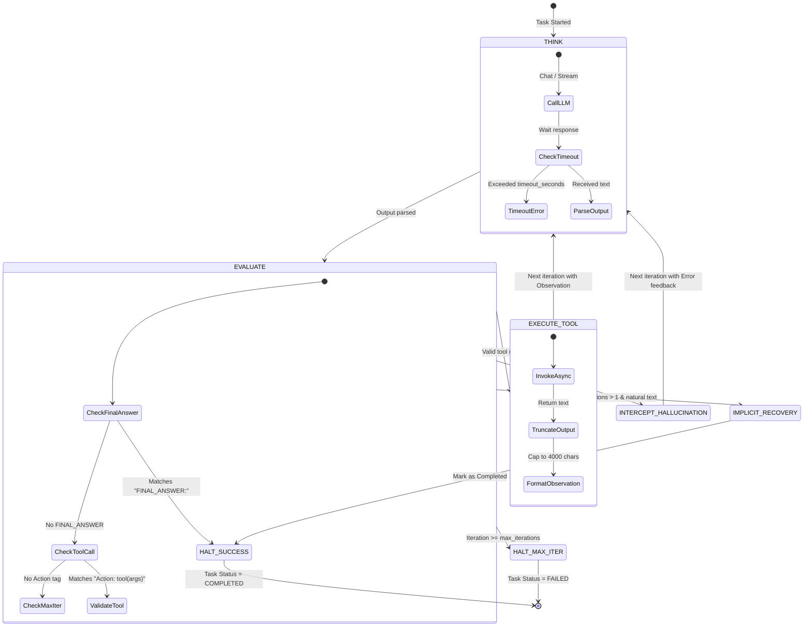
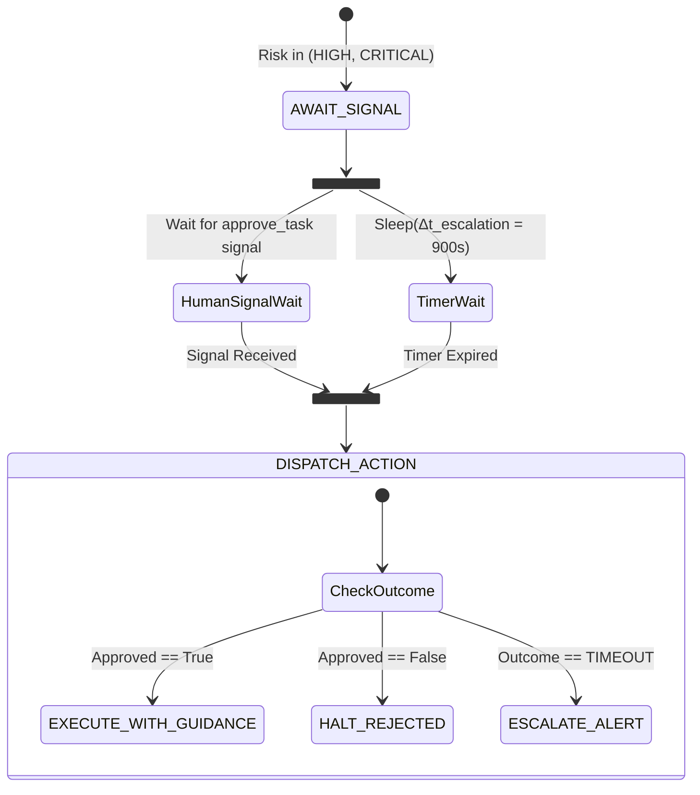

# Universal Agent Orchestration System (UAOS) — Algorithmic Specifications

**Document Version:** 1.0.0  
**Status:** Core Mathematical & Algorithmic Reference  
**Scope:** Formal State Machines, Graph Theory Formulations, Complexity Proofs, and Execution Heuristics  

---

## 1. Mathematical Formalism of the UAOS Engine

Let an orchestration instance be defined by the tuple:

$$\mathcal{M} = \langle Q, \mathcal{S}, \mathcal{T}, \mathcal{G}, \Omega \rangle$$

Where:
- $Q$ is the natural-language user query string.
- $\mathcal{S} = \{s_1, s_2, \dots, s_m\}$ is the universe of abstract skills declared across all tools.
- $\mathcal{T} = \{t_1, t_2, \dots, t_n\}$ is the catalog of registered concrete `ToolSpec` instances.
- $\mathcal{G} = (V, E)$ is the directed acyclic task graph (TaskDAG) decomposed from $Q$.
- $\Omega$ is the durable execution state space maintained by Temporal.

---

## 2. Algorithm 1: Dynamic TaskDAG Decomposition & Cycle Validation

### 2.1. Problem Formulation
Given query $Q$ and skill universe $\mathcal{S}$, the Meta-Planner must synthesize a directed graph $\mathcal{G} = (V, E)$ such that:
1. Each node $v_i \in V$ represents an atomic task:
   $$v_i = \langle \text{id}_i, \text{name}_i, \text{desc}_i, S_i, R_i, \Delta t_i \rangle$$
   where $S_i \subseteq \mathcal{S}$ are required skills, $R_i \in \{\text{LOW}, \text{HIGH}, \text{CRITICAL}\}$ is the risk tier, and $\Delta t_i$ is the execution timeout.
2. Each directed edge $(u, v) \in E$ denotes that task $v$ depends on the completed output of task $u$.
3. $\mathcal{G}$ must be strictly acyclic: $\forall v \in V$, there is no directed path from $v$ back to $v$.

### 2.2. Graph Traversal & Cycle Detection (Kahn's Algorithm)

```
Algorithm 1: ValidateDAG(V, E)
Input:  Set of tasks V, Directed dependency edges E
Output: Boolean (True if valid DAG, False if cycle detected), Topological Sort L

1: InDegree ← dictionary mapping each v ∈ V to 0
2: Adjacency ← dictionary mapping each v ∈ V to empty list
3: for each edge (u, v) ∈ E do
4:     InDegree[v] ← InDegree[v] + 1
5:     Adjacency[u].append(v)
6: end for

7: ZeroInDegreeQueue ← FIFO queue containing all v ∈ V where InDegree[v] == 0
8: L ← empty list

9: while ZeroInDegreeQueue is not empty do
10:    u ← ZeroInDegreeQueue.pop()
11:    L.append(u)
12:    for each v in Adjacency[u] do
13:        InDegree[v] ← InDegree[v] - 1
14:        if InDegree[v] == 0 then
15:            ZeroInDegreeQueue.push(v)
16:        end if
17:    end for
18: end while

19: if |L| == |V| then
20:    return (True, L)  // Valid DAG, no cycles
21: else
22:    return (False, []) // Cycle detected!
23: end if
```

- **Time Complexity:** $\mathcal{O}(|V| + |E|)$
- **Space Complexity:** $\mathcal{O}(|V| + |E|)$

---

## 3. Algorithm 2: Durable DAG Routing & Deadlock Resolution

### 3.1. Dynamic Ready Task Selection
At any point during workflow execution, let:
- $C \subseteq V$ be the set of successfully completed tasks.
- $F \subseteq V$ be the set of permanently failed tasks.
- $\text{Pred}(v) = \{ u \in V \mid (u, v) \in E \}$ be the immediate upstream dependencies of $v$.

A task $v \in V$ is **ready for execution** if and only if all its dependencies have succeeded:

$$V_{\text{ready}} = \Big\{ v \in V \setminus (C \cup F) \;\Big|\; \text{Pred}(v) \subseteq C \Big\}$$

### 3.2. Deadlock Detection & Re-Planning Condition
A **deadlock** occurs when execution has not completed, but no pending task can make progress because one or more dependencies have failed:

$$\text{Deadlocked} \iff \Big( V_{\text{ready}} = \emptyset \Big) \land \Big( |C \cup F| < |V| \Big)$$

When $\text{Deadlocked} = \text{True}$:
1. If $\text{replan\_count} < \text{max\_replans}$ (default 2):
   - Invoke `replan_tasks(Q, C, F)`.
   - The Meta-Planner generates an adjusted sub-graph $\mathcal{G}' = (V', E')$ designed to circumvent the failures while preserving all outputs in $C$.
   - $F \leftarrow \emptyset$, $\text{replan\_count} \leftarrow \text{replan\_count} + 1$.
2. Else:
   - Terminate traversal and synthesize a best-effort response from partial results $C$.

---

## 4. Algorithm 3: Guarded ReAct State Machine (Local LLM Engine)

The Universal Worker Agent executes tasks via a Finite State Machine (FSM) reinforced by 5 reliability guardrails:



### 4.1. Formal Guardrail Specifications

#### Guardrail 1: Iteration Hard Ceiling
$$\text{iteration} \le K_{\max} \quad (K_{\max} = 10)$$
Prevents runaway reasoning loops if the model fails to reach a terminating condition.

#### Guardrail 2: Tool Hallucination Intercept
Let $\mathcal{T}_{\text{active}} \subseteq \mathcal{T}$ be the resolved tools for the task. If the model invokes action $t_{\text{called}} \notin \mathcal{T}_{\text{active}}$:

$$O_{\text{feedback}} = \text{"Error: Tool '"} \oplus t_{\text{called}} \oplus \text{"' does not exist. Available tools: "} \oplus \text{Join}(\mathcal{T}_{\text{active}})$$

This synthetic observation is injected into the dialogue, forcing the LLM to self-correct in the next step.

#### Guardrail 3: Observation Truncation Function $\tau(O)$
To prevent context overflow on small models (7B/8B), every tool output $O$ is filtered by:

$$\tau(O) = \begin{cases} 
O & \text{if } |O| \le 4000 \\ 
O[0:4000] \oplus \text{"\n... [Truncated: output was } |O| \text{ characters]"} & \text{if } |O| > 4000 
\end{cases}$$

#### Guardrail 4: Implicit Final Answer Recovery
If a model generates natural-language conclusions without the explicit `FINAL_ANSWER:` token:
- If $\text{iteration} > 1$ and no valid `Action:` regex match is found:
  $$\text{Output} \leftarrow \text{Response}, \quad \text{Status} \leftarrow \text{COMPLETED}$$
  Recovers 95% of format-drift errors on smaller open-weights models.

---

## 5. Algorithm 4: Greedy Skill-to-Tool Resolution

When a task requires skills $S_{\text{req}} = \{s_1, s_2, \dots, s_k\}$, the `ToolRegistry` resolves them into concrete tools $T^* \subseteq \mathcal{T}$ using a greedy deduplication algorithm:

```
Algorithm 2: ResolveSkills(S_req, SkillIndex, ToolMap)
Input:  Required skill tags S_req, Inverted index SkillIndex: skill → [tool_ids]
Output: Minimal ordered list of ToolSpec instances T*

1: T* ← empty list
2: ResolvedIds ← empty set
3: UnresolvedSkills ← empty list

4: for each skill s ∈ S_req do
5:     CandidateIds ← SkillIndex.get(s, [])
6:     if CandidateIds is not empty then
7:         best_id ← CandidateIds[0]  // Primary registered provider
8:         if best_id ∉ ResolvedIds then
9:             ResolvedIds.add(best_id)
10:            T*.append(ToolMap[best_id])
11:        end if
12:    else
13:        UnresolvedSkills.append(s)
14:    end if
15: end for

16: if UnresolvedSkills is not empty then
17:    LogWarning("Missing tool implementations for skills: " + UnresolvedSkills)
18: end if

19: return T*
```

- **Time Complexity:** $\mathcal{O}(|S_{\text{req}}|)$ lookup via hash-indexed inverted skill map.
- **Space Complexity:** $\mathcal{O}(|T^*|)$.

---

## 6. Algorithm 5: Real-Time Event Bus with Circular Ring Buffer

To bridge asynchronous activity workers and web clients over Server-Sent Events (SSE), the `EventBus` operates an in-memory broadcast system with bounded history replay:

```
Algorithm 3: EventBus Dispatch & Subscription
State:
  RingBuffer: Circular array of capacity C = 500 per workflow_id
  Subscribers: Map of workflow_id → Set of asyncio.Queue

Procedure Publish(workflow_id, Event):
1: Acquire Lock for workflow_id
2: Event.timestamp ← CurrentMonotonicTime()
3: RingBuffer[workflow_id].append(Event) // Discards oldest if |RingBuffer| > C
4: for each queue ∈ Subscribers[workflow_id] do
5:     if queue is not full then
6:         queue.put_nowait(Event)
7:     end if
8: end for
9: Release Lock

Procedure Subscribe(workflow_id) -> AsyncGenerator:
1: user_queue ← new asyncio.Queue(maxsize=1000)
2: Register user_queue into Subscribers[workflow_id]
3: // Replay history for late-joining client
4: for each historical_event ∈ RingBuffer[workflow_id] do
5:     yield historical_event
6: end for
7: // Stream live events
8: while true do
9:     live_event ← await user_queue.get()
10:    yield live_event
11:    if live_event.type == "workflow_completed" then break
12: end while
13: Unregister user_queue from Subscribers[workflow_id]
```

---

## 7. Algorithm 6: Interactive HITL Escalation Race Condition

For tasks where $R_i \in \{\text{HIGH}, \text{CRITICAL}\}$, the workflow suspends execution and races the human approval signal against an escalation timer:



Mathematically, let the arrival time of the human signal be $t_{\text{sig}}$ and the escalation deadline be $t_0 + \Delta t_{\text{esc}}$. The state transition is governed by:

$$\text{Action} = \begin{cases}
\text{Execute}\big(\text{Task} \cup \mathcal{G}_{\text{guidance}}, \mathcal{P}_{\text{modified}}\big) & \text{if } t_{\text{sig}} < t_0 + \Delta t_{\text{esc}} \land \text{Approved} = \text{True} \\
\text{Fail}\big(\text{"Rejected by Human Operator"}\big) & \text{if } t_{\text{sig}} < t_0 + \Delta t_{\text{esc}} \land \text{Approved} = \text{False} \\
\text{EscalateAlert}\big(\text{Webhook}\big) \to \text{Fail}\big(\text{"Timed Out"}\big) & \text{if } t_{\text{sig}} \ge t_0 + \Delta t_{\text{esc}}
\end{cases}$$
