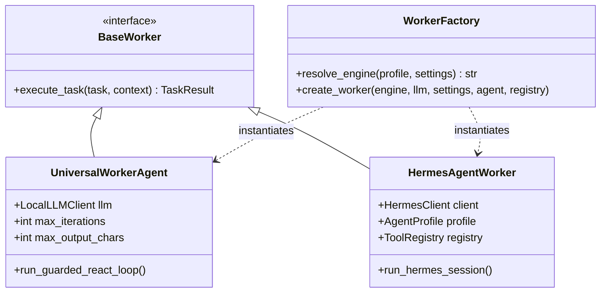
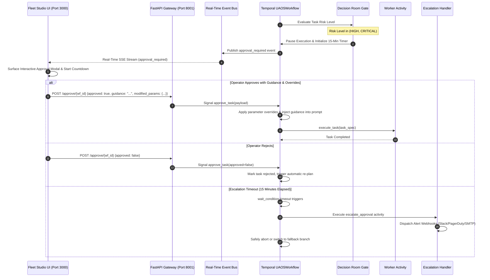

# Universal Agent Orchestration System (UAOS) & Fleet Studio — System Architecture

**Document Version:** 2.0.0  
**Status:** Production & Enterprise Ready  
**Scope:** Complete End-to-End System Design, Component Topologies, Communication Protocols, Dual-Worker Engines, Governance Decision Rooms, and Fleet Arena  

---

## 1. Architectural Philosophy & Core Tenets

Traditional multi-agent frameworks (e.g., CrewAI, AutoGen, ChatDev) exhibit fundamental vulnerabilities when deployed in production enterprise environments:
1. **Unbounded Conversational Drifts**: Agents conversing in unstructured, multi-party natural language enter infinite loops, lose track of goals, and hallucinate consensus.
2. **Hardcoded Role Silos**: Monolithic agent personas (e.g., "SOC Analyst", "Financial Auditor", "Software Engineer") require continuous codebase refactoring whenever operational requirements change.
3. **Volatile In-Memory Execution**: Python in-memory state machines fail catastrophically during process crashes, network partitions, or container restarts, forcing full workflow re-execution.
4. **Ungoverned Tool Invocations**: Direct, unmonitored tool calls without formal risk categorization, air-gap residency controls, or durable human approvals create severe security vulnerabilities.

UAOS and Fleet Studio resolve these flaws through six foundational architectural pillars:

```
┌─────────────────────────────────────────────────────────────────────────────────────────────────┐
│                                   UAOS ARCHITECTURAL PILLARS                                    │
├──────────────────────────────┬──────────────────────────────┬───────────────────────────────────┤
│ 1. Dynamic TaskDAG Planning  │ 2. Dual-Engine Workers       │ 3. Durable Orchestration          │
│ Any arbitrary enterprise     │ • UniversalWorkerAgent:      │ Temporal durable state engine     │
│ query is decomposed into a   │   Stateless guarded ReAct    │ persists transitions to database. │
│ validated directed acyclic   │ • HermesAgentWorker:         │ Zero state loss on container      │
│ graph (TaskDAG) at runtime.  │   Native Hermes 0.21.x runs  │ crash; standalone direct fallback.│
├──────────────────────────────┼──────────────────────────────┼───────────────────────────────────┤
│ 4. Specialized Fleet Compose │ 5. Sovereign Decision Rooms  │ 6. Standardized Protocol Fabric   │
│ 1 Task Node = 1 Dedicated    │ Interactive HITL approvals,  │ Native MCP (stdio/SSE), OpenAPI   │
│ Autonomous Execution Unit    │ 15-min countdown timer, race │ 3.0 / Swagger auto-importer, and  │
│ (AEU); Anti-Persona mandate. │ conditions, and air-gap gate.│ 13 enterprise security connectors.│
└──────────────────────────────┴──────────────────────────────┴───────────────────────────────────┘
```

---

## 2. Global System Topology

The following diagram illustrates the complete end-to-end component topology, data flows, and protocol boundaries across the system:

```mermaid
flowchart TD
    User([Enterprise Operator / Solutions Architect])
    
    subgraph Presentation Layer [Presentation & Control Plane]
        FSUI["Fleet Studio Mission Control\n(Next.js 16 / React 19 / Turbopack / xyflow)\nPort 3000"]
        TUI["Temporal Web UI\nPort 8234 / 8233"]
    end

    subgraph Gateway Layer [FastAPI Gateway & Real-Time Event Bus]
        API["AgentHub FastAPI Gateway\n(Port 8001 / 8000)\nREST, SSE, Uploads, Auth"]
        EB["Real-Time Event Bus Pub/Sub\n(Circular Ring Buffer C=500 + Async Queues)"]
    end

    subgraph Orchestration Layer [Durable Orchestration Engine]
        TS[("Temporal Server\nPort 7234 / 7233")]
        WF["UAOSWorkflow\n(Durable DAG Router & Signal Listener)"]
        SDE["Standalone Direct Execution Engine\n(In-Process Async Fallback)"]
        ACT["Worker Activity Execution Host\n(worker_runner.py)"]
    end

    subgraph Brain & Fleet Subsystems [Brain, Synthesis & Fleet Subsystems]
        MP["Meta-Planner\n(Task Decomposition & JSON Extraction)"]
        ENV["Environment Scanner & Preflight Engine\n(Residency, Baseline & Tool Discovery)"]
        MFA["MissionFleetArchitect & FleetComposer\n(1 Task = 1 Dedicated AEU)"]
        ARENA["Fleet Arena & ArenaStore\n(Named Profiles, ELO Ranking & Benchmarks)"]
        PS["Persona Synthesizer\n(Dynamic Context & Tool Binding)"]
        RA["Response Assembler & Solution Cleaner\n(Executive Deliverable Synthesis)"]
    end

    subgraph Dual Worker Engines [Dual Worker Execution Layer]
        UWA["UniversalWorkerAgent\n(Guarded ReAct FSM + 5 Local LLM Guardrails)"]
        HWA["HermesAgentWorker\n(Hermes v0.21.x Native Integration + Loopback Bridge)"]
    end

    subgraph Memory & Distillation [Long-Term Memory & Distillation Layer]
        MS[("SQLite + FTS5 Memory Store\n(Episodes, Facts, Lessons & Secrets Masking)")]
        MR["MemoryRetriever\n(Bounded Token Budget Context Injection)"]
        SD["SkillDistiller & Manager\n(AST-Guarded Skill Extraction & Promotion)"]
    end

    subgraph Governance & Decision Rooms [Sovereign Governance & Decision Rooms]
        DR["Decision Rooms Engine\n(Policy Verification & Air-Gap Compliance)"]
        AG["Interactive Approval Gate\n(15-Min Timer, Guidance & Param Overrides)"]
        ESC["Escalation Alert Webhooks\n(Slack, PagerDuty, SMTP)"]
    end

    subgraph Standardized Tool & Connector Fabric [Tool & Protocol Fabric]
        TR["Central ToolRegistry\n(Abstract Skills Inverted Index)"]
        NATIVE["Native Starter Tools\n(Code Exec, File Ops, Web Search)"]
        MCP["MCP Client (stdio / SSE) & Server\n(JSON-RPC 2.0 Protocol)"]
        OAS["OpenAPI 3.0 / Swagger Auto-Importer\n(Dynamic HTTP REST Engine)"]
        CONN["13 Enterprise Security Connectors\n(CrowdStrike, Defender, Splunk, Elastic, Sentinel...)"]
    end

    subgraph Inference Cluster [Local Sovereign Inference]
        LLM["Local LLMs (LM Studio, Ollama, vLLM, llama.cpp)\ne.g. openai/gpt-oss-20b, llama3.1, qwen2.5"]
    end

    %% Presentations & Gateway Connections
    User <-->|HTTP / Browser| FSUI
    User <-->|Temporal Dashboard| TUI
    FSUI <-->|REST API & SSE Stream| API
    API <-->|Subscribe Events / Circular Replay| EB
    API <-->|Start Workflow / Signals / Queries| TS
    API <-->|Direct In-Process Fallback| SDE

    %% Orchestration Flows
    TS <-->|Durable Execution Log| WF
    WF -->|Schedules Activities| ACT
    SDE -->|Executes Direct Tasks| ACT

    %% Brain & Planning Flows
    ACT -->|1. plan_tasks| MP
    ACT -->|2. preflight_scan| ENV
    ACT -->|3. compose_fleet| MFA
    ACT -->|4. execute_task| UWA
    ACT -->|4b. execute_hermes_task| HWA
    ACT -->|5. assemble_response| RA

    MP <-->|Prompts & Schema Validation| LLM
    MP -.->|Queries Abstract Skills| TR
    ENV -.->|Discovers Environment| TR

    %% Worker Execution Flows
    UWA -->|Synthesize Persona| PS
    UWA <-->|chat & chat_stream| LLM
    UWA -->|Execute Tool Invocations| TR
    UWA -.->|Emit Tokens & Tool Events| EB

    HWA -->|Hermes Client JSON-RPC| LLM
    HWA -->|Execute Scoped Tools| TR
    HWA -.->|Emit Logs & Events| EB

    %% Memory & Distillation Flows
    ACT -->|Record Trace| MS
    MR -->|Search Facts & Episodes| MS
    MR -.->|Inject Grounded Memory| PS
    SD -->|Parse AST of Completed Workflows| MS
    SD -->|Register Distilled Tool| TR

    %% Governance & Approvals
    WF -->|High/Critical Risk Detected| DR
    DR -->|Surface Approval Gate| AG
    AG -->|Stream to UI| EB
    User -->|Approve with Guidance| API
    API -->|Signal approve_task| WF
    AG -->|Timeout Expired (900s)| ESC

    %% Tool Registry Integrations
    TR --> NATIVE
    TR --> MCP
    TR --> OAS
    TR --> CONN
```

---

## 3. Component Deep Dive

### 3.1. Meta-Planner & Pre-Flight Environment Scanner
- **Meta-Planner (`src/brain/meta_planner.py`)**:
  - Ingests the raw user query, attached documents (Word `.docx`, PDF, Excel, JSON), and the available abstract skills catalog.
  - Decomposes problems into a strongly-typed `TaskDAG` with explicit inter-task dependencies, estimated timeouts, required capability tags, and strict risk tiers (`LOW`, `HIGH`, `CRITICAL`).
  - Incorporates multi-stage JSON extraction resilience: scans raw JSON, fenced markdown codeblocks, and boundary brackets with iterative prompt feedback on validation failures.
- **Environment Discovery Engine (`src/brain/environment_scanner.py`)**:
  - Scans host runtime topology, tool availability, and data residency boundaries.
  - Formulates a `MissionEnvironmentManifest` confirming sovereign air-gap isolation before execution commences.

### 3.2. Durable DAG Router & Standalone Direct Engine
- **Durable Temporal Workflow (`src/orchestrator/workflow.py`)**:
  - Operates as a deterministic state machine within the Temporal Cluster.
  - Persists all task transitions, signals, and outputs to an append-only event store. If worker nodes restart or crash, the workflow resumes instantly from the last recorded activity.
  - Dynamically calculates ready tasks ($V_{\text{ready}} = \{v \in V \setminus (C \cup F) \mid \text{Pred}(v) \subseteq C\}$), parallelizes independent task branches, and triggers automatic re-planning upon encountering deadlocks (up to `max_replans = 2`).
- **Standalone Direct Execution Engine (`src/orchestrator/direct_checkpoint.py`)**:
  - Provides a self-contained in-process fallback when Docker or Temporal Server is not running.
  - Directly steps through the `TaskDAG` asynchronously, updating task statuses and piping events to the `EventBus` without requiring external infrastructure.

### 3.3. Dual Worker Execution Engines
UAOS features two distinct worker execution engines managed through `src/workers/factory.py`:



1. **Universal Worker Agent (`src/workers/universal_worker.py`)**:
   - **Blank-Slate Lifecycle**: Spawned for a single task, dynamically injected with persona prompts and scoped tools, and immediately destroyed upon completion. Zero memory leak or conversational drift.
   - **5 Local LLM Reliability Guardrails**:
     - *Iteration Ceiling*: Halts infinite reasoning loops at $K_{\max} = 10$.
     - *Tool Hallucination Intercept*: Intercepts unknown tool calls, feeding back the exact list of registered tools for instant self-correction.
     - *Observation Capping*: Truncates tool outputs at 4,000 characters to safeguard the LLM context window.
     - *Implicit Final Answer Recovery*: Rescues valid conclusions when smaller open models omit the `FINAL_ANSWER:` tag.
     - *Execution Timeout*: Async cancellation preventing frozen inference sockets.
2. **Hermes Agent Worker (`src/workers/hermes_agent_worker.py`)**:
   - Native integration with Hermes Agent v0.21.x.
   - Leverages Hermes profiles, skills catalogs, and JSON-RPC over `/api/ws`.
   - Supports local loopback bridging, dynamic profile synthesis, and native Hermes toolset execution.

### 3.4. Dynamic Fleet Composer & Multi-Agent Arena
- **Mission Fleet Architect (`src/fleet/fleet_composer.py`)**:
  - Enforces the **Anti-Persona Mandate**: Rather than using static monolithic agents, it synthesizes dedicated Autonomous Execution Units (AEUs) where **1 Task Node = 1 Dedicated Micro-Agent** (`TaskSpecialistUnit`).
  - Infers operational stages (`RECON_INGESTION`, `DEEP_ANALYSIS`, `CROSS_VERIFICATION`, `EXECUTION_ACTION`, `DELIVERABLE_SYNTHESIS`).
  - Scopes tool permissions strictly to the skills demanded by each task node.
- **Fleet Arena & ArenaStore (`src/fleet/arena.py`, `src/fleet/arena_store.py`)**:
  - Manages named, reusable agent profiles (`fleet-` prefix).
  - Supports competing fleet topologies where alternative agent configurations solve identical benchmarks.
  - Implements an ELO rating engine tracking agent performance and accuracy across missions.

### 3.5. Sovereign Governance, Decision Rooms & Approval Gates
- **Decision Rooms (`src/governance/`)**:
  - Provides formal human-in-the-loop (HITL) oversight for high-risk actions.
  - Evaluates data residency constraints, ensuring local sovereign air-gap compliance.
- **Interactive Approval Gate**:
  - For tasks marked with `HIGH` or `CRITICAL` risk tiers, execution suspends cleanly via Temporal signals.
  - Features an active 15-minute (900-second) countdown timer.
  - Human operators can:
    - **Approve with Guidance**: Inject natural language guidance comments directly into the worker's prompt.
    - **Override Parameters**: Edit task parameters in real time via JSON editor.
    - **Reject**: Abort task execution or trigger re-planning.
  - **Auto-Escalation**: If the timer expires without human action, the workflow triggers an automatic escalation activity, broadcasting alerts via webhooks and safely falling back.

### 3.6. Standardized Tool & Connector Fabric
- **Model Context Protocol (MCP)**:
  - Supports both `stdio` (subprocess with environment isolation) and `sse` (remote HTTP).
  - Automatically translates MCP `tools/list` schemas into `ToolSpec` instances with semantic risk categorization.
  - In addition to client mode, UAOS provides an embedded Hermes MCP Server (`src/hermes/mcp_server.py`) exposing local tools to external agents.
- **OpenAPI 3.0 / Swagger Auto-Importer**:
  - Dynamically parses OpenAPI specifications (JSON/YAML or live URL).
  - Binds async HTTP requests with automatic header injection and character-capped output.
- **13 Enterprise Security Connectors (`src/connectors/implementations/`)**:
  - Native integration with enterprise telemetry and security systems:
    - *Endpoint / EDR*: CrowdStrike Falcon, Microsoft Defender, SentinelOne.
    - *SIEM / Analytics*: Splunk, Microsoft Sentinel, Elasticsearch.
    - *Identity & Access*: Microsoft Entra ID (Azure AD), Okta.
    - *Network & Firewalls*: Palo Alto Networks, Fortinet FortiGate.
    - *Threat Intel & Incident Response*: VirusTotal, AbuseIPDB, TheHive.

### 3.7. Long-Term Memory & Skill Distillation
- **Memory Store (`src/memory/store.py`, `src/memory/retriever.py`)**:
  - Embedded SQLite database with FTS5 full-text indexing.
  - Stores three core entities:
    - `episodes`: Execution traces, TaskDAGs, and final deliverables.
    - `facts`: System facts with grounding sources and volatile flags.
    - `lessons`: Operational heuristics distilled from successes or failures.
  - Automatic secret masking (credentials, API keys, passwords, bearer tokens).
  - Semantic retrieval within strict context token budgets (default 3,200 characters / ~800 tokens).
- **Skill Distillation Engine (`src/skills/distiller.py`, `src/skills/manager.py`)**:
  - Analyzes successful multi-step execution traces from completed missions.
  - Distills reusable composite Python tools from observed tool sequences.
  - Enforces strict safety through AST (Abstract Syntax Tree) validation, verifying that candidate code contains no forbidden imports or unsafe calls (`eval`, `exec`, `subprocess`, `ctypes`, `socket`).
  - Distilled candidates are submitted to the `EventBus` and reviewed before promotion to `ToolRegistry`.

### 3.8. Fleet Studio Presentation & Control Plane
- **Frontend Architecture (`frontend/frontend/`)**:
  - Built with **Next.js 16**, **React 19**, and **Turbopack**.
  - **xyflow (ReactFlow)** interactive topological TaskDAG visualizer rendering nodes, execution states, dependencies, and bezier connection paths.
  - Sovereign Obsidian & Dark Teal glassmorphic design system.
  - Real-time SSE streaming client consuming live reasoning tokens, tool start/end badges, and interactive approval gates.
  - Comprehensive dropdown context menus across Mission Control, Specialist Roster, Decision Rooms, and Evidence Locker.

---

## 4. Human-in-the-Loop & Decision Room Sequence Flow



---

## 5. Security, Isolation & Air-Gap Compliance Matrix

| Component | Security Mechanism | Threat Mitigated |
| :--- | :--- | :--- |
| **Code Execution Engine** | Isolated temporary workspace (`tempfile`), subprocess timeout (30s), output character capping (4KB) | Host system compromise, infinite loops, resource starvation |
| **OpenAPI Executor** | Parameter type validation, URL path sanitization, in-memory credential injection | SSRF, prompt leakage of API keys, injection attacks |
| **MCP Client (stdio)** | Non-root subprocess invocation, explicit environment whitelist, strict EOF pipe closing | Host process tampering, zombie process exhaustion |
| **Decision Room Gate** | Temporal Signal verification, immutable workflow wait condition, cryptographic token check | Unauthorized execution of destructive actions |
| **Data Residency Enforcer** | Pre-flight environment scan, network routing validation, air-gap residency gate | Unintended egress of sovereign enterprise data |
| **Memory Store** | Regex secret masking (tokens, passwords, keys), volatile keyword tagging, FTS5 sandbox | Credential persistence in logs, memory contamination |
| **Skill Distiller** | AST AST-traversal inspection, forbidden module whitelist (`ctypes`, `subprocess`, `socket`) | Ingestion of malicious or backdoored generated tools |

---

## 6. File-Backed Workflow Artifact Scratchpad & Factual Accuracy Architecture

To resolve context-window truncation cliffs where large upstream outputs (e.g. multi-page RFPs, telemetry dumps, pricing matrices) caused downstream analytical agents to receive truncated data or starve completely, UAOS implements a file-backed structured artifact storage pipeline:

```
┌─────────────────────────────────────────────────────────────────────────────────┐
│                           WORKFLOW ARTIFACT SCRATCHPAD                          │
├─────────────────────────────────────────────────────────────────────────────────┤
│ 1. Upstream Task (Ingestion / Extraction / Analysis)                            │
│    • Emits complete, un-truncated report / payload                              │
│    • WorkflowArtifactExchange writes:                                           │
│      ├── data/artifacts/{workflow_id}/{task_id}_payload.md   (Lossless text)    │
│      └── data/artifacts/{workflow_id}/{task_id}_payload.json (Parsed tables)    │
├─────────────────────────────────────────────────────────────────────────────────┤
│ 2. Context Partitioning & Synthesis (format_upstream_context)                   │
│    • Allocates equitable character share: max(100, min(1500, max_chars // N))   │
│    • Appends explicit disk artifact pointer:                                    │
│      "> Lossless Artifact: data/artifacts/{wf_id}/{task}_payload.md (N bytes)   │
│         For full tables or exact values, inspect this file directly."           │
├─────────────────────────────────────────────────────────────────────────────────┤
│ 3. Downstream Specialist Agent (Pricing / Compliance / Report)                  │
│    • Receives concise executive excerpt + direct disk reference                 │
│    • Mandatory Tool Directives force model to inspect ground-truth disk files   │
├─────────────────────────────────────────────────────────────────────────────────┤
│ 4. Supervisor Evaluation & Factual Grounding (evaluate_task_output)             │
│    • Evaluates worker output against 800-char upstream extracts + disk pointers │
│    • Placeholder Token Guard: Intercepts unpopulated [insert ...], TBD, TODO    │
└─────────────────────────────────────────────────────────────────────────────────┘
```

### 6.1. Semantic DAG Dependency Repair
The `MetaPlanner` incorporates `_repair_dag_dependencies`:
1. **Automated Topological Linking**: Scans for data-gathering tasks (`extract`, `ingest`, `read`, `parse`, `inspect`) and downstream analytical tasks (`price`, `pricing`, `cost`, `proposal`, `summary`, `audit`, `compliance`, `synthesis`). It programmatically injects predecessor dependencies so downstream tasks never run in parallel before raw data is extracted.
2. **Output Contract Enforcement**: Guarantees that every task possesses a structured `expected_output` definition (markdown tables or JSON schema) to prevent models from returning conversational pleasantries.
3. **Cycle Prevention**: Verifies DAG integrity with Kahn's algorithm; falls back to an orderly sequential chain if a cycle is introduced.

---

## 7. Directory Structure & Module Organization

```
d:/projects/aiagent/
├── pyproject.toml              # Dependencies & package metadata
├── Dockerfile                  # Production containerization
├── docker-compose.yml          # Multi-container stack (PostgreSQL, Temporal, Temporal UI)
├── README.md                   # Primary system documentation & quickstart
├── ARCHITECTURE.md             # Architecture summary pointer
├── ALGORITHMS.md               # Algorithmic specifications pointer
├── run.py                      # Multi-process supervisor & auto-launcher
├── start.bat / start.ps1       # One-command startup scripts
├── docs/
│   ├── ARCHITECTURE.md         # This authoritative architecture document
│   ├── ALGORITHMS.md           # Mathematical formalisms & algorithm proofs
│   ├── DEMO_GUIDE.md           # Interactive demo script
│   └── FLEET_STUDIO_PROPOSAL_DEMO_GUIDE.md # Enterprise RFP demo walkthrough
├── frontend/                   # Fleet Studio Next.js 16 Web Application
│   ├── README.md               # Frontend quickstart & overview
│   └── frontend/
│       ├── package.json        # Next.js 16, React 19, xyflow, Lucide
│       └── src/
│           ├── app/            # App router, layout.tsx, globals.css
│           ├── components/     # Mission Control, Roster, Decision Rooms, Modals
│           └── lib/            # Types, API client, SSE streaming handlers
├── src/
│   ├── api/                    # FastAPI Gateway & REST Endpoints
│   │   └── main.py             # 3,200+ LOC Gateway (REST, SSE, Uploads, Dynamic Config)
│   ├── brain/                  # Cognitive & Planning Subsystems
│   │   ├── meta_planner.py     # TaskDAG decomposition & schema validator
│   │   ├── environment_scanner.py # Host topology & air-gap discovery
│   │   └── prompts.py          # Structured prompt engineering
│   ├── connectors/             # Enterprise Security Connectors
│   │   ├── manager.py          # Lifecycle & ToolRegistry registration manager
│   │   ├── base.py             # Base connector abstraction & status models
│   │   └── implementations/    # 13 enterprise connectors (CrowdStrike, Splunk, Defender...)
│   ├── core/                   # Foundation models, configs & telemetry
│   │   ├── models.py           # TaskDAG, TaskResult, RiskLevel, Manifests
│   │   ├── config.py           # Pydantic Settings
│   │   ├── llm_client.py       # Async HTTP client with chat_stream SSE
│   │   ├── document_parser.py  # Word (.docx), PDF, Excel, JSON parser
│   │   └── telemetry.py        # Fleet telemetry tracker
│   ├── fleet/                  # Multi-Agent Fleet & Arena Subsystem
│   │   ├── fleet_composer.py   # MissionFleetArchitect (1 Task = 1 Dedicated AEU)
│   │   ├── arena.py            # Fleet Arena lifecycle & profile provisioning
│   │   └── arena_store.py      # Arena persistence & ELO ranking store
│   ├── governance/             # Sovereign Decision Rooms & HITL
│   ├── hermes/                 # Hermes v0.21.x Native Integration
│   │   ├── profiles.py         # Dynamic Hermes profile management (76KB)
│   │   ├── mcp_server.py       # Embedded Hermes MCP JSON-RPC Server (19KB)
│   │   ├── client.py           # Hermes JSON-RPC API client
│   │   ├── catalog.py          # Skills & tools catalog
│   │   └── provision.py        # Dynamic agent provisioning
│   ├── memory/                 # Long-Term Memory & Embeddings
│   │   ├── store.py            # SQLite + FTS5 store (episodes, facts, lessons)
│   │   ├── retriever.py        # Grounded context retrieval with token budgeting
│   │   └── embeddings.py       # Semantic embedding generator
│   ├── orchestrator/           # Durable Temporal & Direct Orchestration
│   │   ├── workflow.py         # UAOSWorkflow with signals & race conditions
│   │   ├── activities.py       # Activity definitions (plan, execute, assemble)
│   │   ├── event_bus.py        # In-memory pub/sub with circular ring buffer (C=500)
│   │   ├── direct_checkpoint.py# Standalone direct in-process execution engine
│   │   └── worker_runner.py    # Temporal worker process entrypoint
│   ├── persona/                # Persona Synthesizer
│   │   └── synthesizer.py      # Dynamic prompt synthesis & context truncation
│   ├── registry/               # Tool discovery, registry & protocol adapters
│   │   ├── tool_registry.py    # Central catalog & inverted skill index
│   │   ├── auto_discover.py    # Auto-discovers local tools ending in _SPEC
│   │   ├── mcp/                # Model Context Protocol adapter & client
│   │   ├── openapi/            # OpenAPI 3.0 / Swagger auto-importer
│   │   └── tools/              # Native starter tools
│   ├── skills/                 # Autonomous Skill Distillation
│   │   ├── distiller.py        # AST-guarded skill extractor from execution traces
│   │   └── manager.py          # Candidate review & registration manager
│   ├── ui/                     # Legacy static HTML dashboard
│   └── workers/                # Dual Worker Execution Engines
│       ├── factory.py          # Worker factory & engine selector
│       ├── universal_worker.py # Blank-slate ReAct worker with 5 guardrails (50KB)
│       └── hermes_agent_worker.py # Hermes v0.21.x native worker (40KB)
└── tests/                      # Comprehensive Unit, Integration & Benchmark Tests
```
