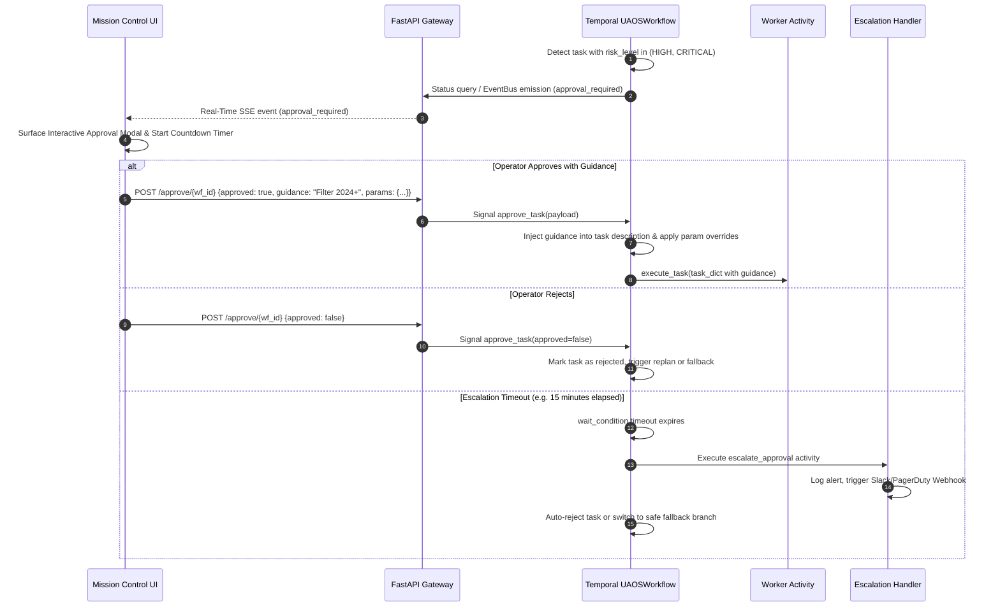

# Universal Agent Orchestration System (UAOS) — System Architecture

**Document Version:** 1.0.0  
**Status:** Production / Commercial Ready  
**Scope:** Complete End-to-End System Design, Component Topologies, Communication Protocols, and Lifecycle Management  

---

## 1. Architectural Philosophy & Core Tenets

Traditional multi-agent architectures (e.g. CrewAI, AutoGen, ChatDev) suffer from three fatal flaws in production environments:
1. **Brittle Conversational Loops**: Agents conversing in free-form natural language often get trapped in infinite reasoning loops, drift away from goals, and hallucinate consensus.
2. **Hardcoded Role Silos**: Hardcoding specialized agents (e.g., "SOC Analyst", "Financial Researcher", "Python Developer") requires re-engineering the codebase for every new use case.
3. **Volatile In-Memory State**: Frameworks using Python in-memory state machines fail completely if a worker process crashes, loses power, or restarts, forcing the entire workflow to re-run from scratch.

UAOS solves these problems by establishing four core architectural tenets:

```
┌─────────────────────────────────────────────────────────────────────────────────┐
│                           UAOS ARCHITECTURAL PILLARS                            │
├─────────────────────────┬─────────────────────────────┬─────────────────────────┤
│ 1. Dynamic Decomposition│ 2. Blank-Slate Workers      │ 3. Durable Orchestration│
│ Any arbitrary problem is│ Agents are spawned blank-   │ Temporal persists state │
│ decomposed into a       │ slate per task, injected with│ transitions to DB; full │
│ validated TaskDAG at    │ dynamic tools & personas,   │ replay & non-blocking   │
│ runtime by MetaPlanner. │ and destroyed on completion.│ HITL without CPU burn.  │
├─────────────────────────┴─────────────────────────────┴─────────────────────────┤
│ 4. Protocol Standardization (MCP & OpenAPI)                                     │
│ Zero custom wrapper code required. Directly connects to Model Context Protocol  │
│ servers (stdio/SSE) and auto-ingests OpenAPI 3.0/Swagger specifications.        │
└─────────────────────────────────────────────────────────────────────────────────┘
```

---

## 2. Global System Topology

The following diagram illustrates the complete end-to-end component topology, data flows, and protocol boundaries across the system:

```mermaid
flowchart TD
    User([User / External Client])
    UI[Mission Control Web UI\n(HTML5 / Obsidian Glassmorphism / SVG DAG)]
    API[FastAPI Gateway\n(Port 8000 / 8001)]
    
    subgraph Core Engine
        EB[Event Bus Pub/Sub\n(Circular Buffer + Async Queues)]
        TR[ToolRegistry\n(Abstract Skills Index)]
    end

    subgraph Temporal Orchestration
        TS[(Temporal Server\nPort 7233)]
        WF[UAOSWorkflow\n(Durable DAG Router)]
        ACT[Activity Execution Host\n(Worker Runner)]
    end

    subgraph Agent Subsystems
        MP[Meta-Planner\n(Decomposition Engine)]
        PS[Persona Synthesizer\n(Dynamic Context & Prompts)]
        UWA[Universal Worker Agent\n(Guarded ReAct Loop)]
        RA[Response Assembler\n(Synthesis Engine)]
    end

    subgraph Standardized Tool Ecosystem
        NATIVE[Native Tools\n(Code Exec, File Ops, Web Search)]
        MCP[MCP Client\n(JSON-RPC over stdio / SSE)]
        OAS[OpenAPI Executor\n(Dynamic HTTP REST Engine)]
    end

    subgraph Inference Cluster
        LLM[Local / Remote LLMs\n(LM Studio / Ollama / vLLM)]
    end

    User <-->|HTTP / SSE Stream| UI
    UI <-->|REST & EventSource| API
    API <-->|Workflow Start / Signal / Query| TS
    API <-->|Subscribe Events| EB
    
    TS <-->|Durable Event Log| WF
    WF -->|Schedules Activities| ACT
    
    ACT -->|1. plan_tasks| MP
    ACT -->|2. execute_task| UWA
    ACT -->|3. replan_tasks| MP
    ACT -->|4. assemble_response| RA

    MP <-->|Prompt & JSON Extract| LLM
    MP -.->|Queries Available Skills| TR
    
    UWA -->|Synthesize Persona| PS
    UWA <-->|chat & chat_stream| LLM
    UWA -->|Execute Tool Calls| TR
    UWA -.->|Live Tokens & Events| EB
    
    TR --> NATIVE
    TR --> MCP
    TR --> OAS
```

---

## 3. Component Deep Dive

### 3.1. Meta-Planner (`src/brain/meta_planner.py`)
- **Role**: Problem decomposition engine.
- **Inputs**: Raw user query string + list of available abstract skills from `ToolRegistry.list_skills()`.
- **Outputs**: Strongly-typed `TaskDAG` with explicit task dependencies, required skill tags, estimated timeouts, and risk tiers (`LOW`, `HIGH`, `CRITICAL`).
- **Resilience Strategy**:
  - Structured prompt enforcing strict JSON schema.
  - Multi-stage JSON extractor (handles raw JSON, markdown ```json codeblocks, and boundary scanning).
  - Feedback retry loop on malformed JSON.
  - Fail-safe fallback decomposition if the local LLM fails all retries, preventing system halts.

### 3.2. Durable DAG Router (`src/orchestrator/workflow.py`)
- **Role**: Deterministic, durable state machine running within Temporal.
- **Fault-Tolerance**: Temporal records every activity start, completion, and signal in an append-only event log. If worker containers crash, the workflow is resumed on an alternate worker without losing progress.
- **Topological Traversal**:
  - Dynamically calculates `ready_tasks` where `task.dependencies ⊆ completed_task_ids`.
  - Executes ready branches.
  - Detects deadlocks: if remaining tasks depend on failed upstream tasks, triggers an automatic `replan_tasks` activity up to `max_replans = 2`.

### 3.3. Tool Registry & Integration Ecosystem (`src/registry/`)
- **Abstract Skill vs Concrete Tool**:
  - Meta-Planner only sees high-level capability names (`database`, `code_execution`, `web_search`).
  - `ToolRegistry` maps abstract skills to concrete `ToolSpec` objects.
- **Model Context Protocol (MCP)**:
  - Supports `stdio` (spawning child processes via `asyncio.subprocess` with isolated environments) and `sse` (remote HTTP).
  - Translates MCP `tools/list` JSON schemas into `ToolSpec` instances with automatic semantic risk tiering.
- **OpenAPI 3.0 / Swagger Auto-Importer**:
  - Ingests REST specifications (JSON/YAML or URL).
  - Flattens path, query, header, and body parameters.
  - Dynamically binds an async HTTP client (`httpx`) that handles URL substitution, authentication headers, and character-capped output.

### 3.4. Persona Synthesizer (`src/persona/synthesizer.py`)
- **Role**: Per-task prompt engineering and context pruning.
- **Dynamic Assembly**:
  - Role definition tailored to the task description.
  - Injects precise parameter schemas for only the tools resolved for this specific task.
  - Upstream context pruning: aggregates outputs from dependency tasks, capping character counts to prevent context window explosion on 8B/7B models.

### 3.5. Universal Worker Agent (`src/workers/universal_worker.py`)
- **Role**: Stateless, blank-slate execution unit.
- **Guarded ReAct Finite State Machine**:
  - `Thought` ➔ `Action: tool_name(args)` ➔ `Observation: result` ➔ `FINAL_ANSWER: ...`
  - Zero cross-task memory leaks. The worker instance is instantiated for a single task and discarded.
  - 5 Local LLM Reliability Guardrails:
    1. **Max Iterations Threshold**: Halts infinite reasoning.
    2. **Tool Hallucination Intercept**: Returns explicit tool errors with lists of registered tools when models hallucinate tool names.
    3. **Observation Output Truncation**: Caps tool returns to 4000 characters.
    4. **Implicit Final Answer Recovery**: Captures natural language answers if models omit the `FINAL_ANSWER:` tag.
    5. **Task Execution Timeout**: Async cancellation prevents hanging inference servers.

### 3.6. Real-Time Streaming Event Bus (`src/orchestrator/event_bus.py`)
- **Role**: Decoupled pub/sub event broadcaster bridging async Temporal activities and FastAPI SSE clients.
- **Mechanism**:
  - Maintains per-workflow subscriber queues (`asyncio.Queue`).
  - Circular ring-buffer stores the last 500 events per workflow so late-joining clients or page reloads immediately catch up.
  - Emits: `token`, `tool_start`, `tool_end`, `approval_required`, `approval_resolved`, and `final_solution`.

---

## 4. Human-in-the-Loop (HITL) & Escalation Architecture



---

## 5. Security & Isolation Matrix

| Component | Security Mechanism | Threat Mitigated |
| :--- | :--- | :--- |
| **Code Executor** | Subprocess timeout (30s), cwd isolation (`tempfile`), output truncation (4KB) | Resource exhaustion, runaway loops |
| **OpenAPI Executor** | Header/Token encryption in memory, parameter validation, URL sanitization | Credential leakage in prompts, SSRF |
| **MCP Client (stdio)** | Non-root subprocess spawning, environment variable whitelist, pipe EOF handling | Host system tampering, zombie processes |
| **Approval Gate** | Cryptographically verified Temporal Signals, non-bypassable workflow wait | Unauthorized execution of destructive actions |
| **Output Truncation** | Hard character capping on all tool outputs and prompt assembly | Prompt injection via large payloads, context overflow |

---

## 6. Directory Structure & Module Organization

```
d:/projects/aiagent/
├── pyproject.toml              # Dependencies & package metadata
├── Dockerfile                  # Production containerization
├── docker-compose.yml          # Multi-container orchestration (Temporal + API + SearXNG)
├── README.md                   # System documentation & quickstart
├── run.py                      # Multi-process supervisor with auto port collision detection
├── docs/
│   ├── ARCHITECTURE.md         # This document
│   └── ALGORITHMS.md           # Algorithmic & mathematical specifications
├── src/
│   ├── core/                   # Foundation models, config, exceptions, LLM client
│   │   ├── models.py           # Task, TaskDAG, TaskResult, RiskLevel, TaskStatus
│   │   ├── config.py           # Pydantic Settings
│   │   ├── llm_client.py       # Async HTTP client with chat & chat_stream SSE
│   │   └── exceptions.py       # Structured exception hierarchy
│   ├── registry/               # Tool discovery, registry, and protocol adapters
│   │   ├── tool_registry.py    # Central catalog, skill index, dynamic batching
│   │   ├── auto_discover.py    # Auto-discovers local modules ending in _SPEC
│   │   ├── mcp/                # Model Context Protocol client & adapter
│   │   │   ├── mcp_client.py   # JSON-RPC 2.0 client (stdio & sse)
│   │   │   └── mcp_adapter.py  # Schema converter & semantic risk evaluator
│   │   ├── openapi/            # OpenAPI 3.0 / Swagger auto-importer
│   │   │   ├── openapi_parser.py # Spec parser & parameter flattener
│   │   │   └── openapi_executor.py # Dynamic HTTP client with auth injection
│   │   └── tools/              # Native starter tools (code_exec, file_ops, web_search)
│   ├── brain/                  # Meta-Planner & decomposition prompts
│   │   ├── prompts.py          # Structured system prompts
│   │   └── meta_planner.py     # DAG decomposition, JSON extraction, cycle validator
│   ├── persona/                # Persona Synthesizer
│   │   └── synthesizer.py      # Dynamic prompt synthesis & context truncation
│   ├── workers/                # Blank-slate Universal Worker Agent
│   │   └── universal_worker.py # Guarded ReAct loop with streaming callbacks
│   ├── orchestrator/           # Temporal durable orchestration & event streaming
│   │   ├── workflow.py         # UAOSWorkflow with interactive signals & escalation
│   │   ├── activities.py       # plan_tasks, execute_task, replan, assemble, escalate
│   │   ├── event_bus.py        # In-memory pub/sub event broadcaster
│   │   └── worker_runner.py    # Temporal worker process entrypoint
│   ├── api/                    # FastAPI Gateway
│   │   └── main.py             # REST endpoints, SSE stream route, MCP/OpenAPI management
│   └── ui/                     # Mission Control Web Dashboard
│       ├── index.html          # Neo-Obsidian layout, SVG DAG visualizer, Modals
│       ├── css/style.css       # Design tokens, glassmorphism, animations
│       └── js/
│           ├── app.js          # State management, SSE consumer, modal handlers
│           └── dag_renderer.js # Topological SVG DAG renderer with bezier curves
└── tests/                      # 30+ Unit and Integration Tests
```
