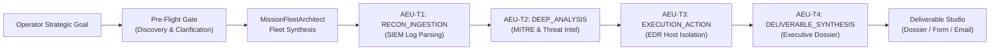

# UAOS Mission-to-Fleet Platform — Interactive Demo Guide & Enterprise Use Case

> **Target Audience**: Enterprise Operators, Solutions Architects, and Stakeholder Demonstrators  
> **Platform URL**: `http://127.0.0.1:8000/`  
> **Execution Engine**: Durable State Engine (`src/orchestrator/workflow.py`) with Standalone Direct Fallback (`src/api/main.py`)  

---

## 1. Executive Concept: From Task Prompting to Strategic Fleet Expansion

In traditional agent systems, operators write procedural instructions (*"First query Splunk for IP X, then run an EDR query, then draft a memo"*).

In **UAOS**, the operator simply supplies a **Strategic Mission Goal**:
```text
Autonomous SOC Incident Triage & Response: Ingest SIEM security alerts, 
isolate compromised host via EDR, and compile executive incident dossier.
```

The platform autonomously:
1. **Scans the execution environment** (connectors, tools, attached files).
2. **Engages the operator via a Pre-Flight Clarification Gate** to resolve mission boundaries.
3. **Expands the strategic goal into an Autonomous Fleet of Specialized Units** (`AEU-T1` through `AEU-T4`) assigned to discrete operational stages (`RECON_INGESTION`, `DEEP_ANALYSIS`, `CROSS_VERIFICATION`, `EXECUTION_ACTION`, `DELIVERABLE_SYNTHESIS`).
4. **Enforces deterministic Anti-Persona standards** (strict functional units with contracts, no roleplay).
5. **Delivers outputs through a Multi-Channel Deliverable Studio** (Executive Dossier, Interactive Form with JSON/CSV export, and RFC 822 `.eml` / `mailto:` email).

---

## 2. Featured Walkthrough Use Case: Autonomous SOC Incident Triage

### Scenario
An enterprise security operations center receives high-volume alert telemetry. The operator needs the system to autonomously ingest SIEM logs, cross-reference IOCs against threat intelligence, isolate affected endpoints via EDR, and generate an executive-ready incident dossier.



---

## 3. Step-by-Step Live Demo Execution

### Step 1: Access the Mission Control Console
- Open your browser to: **`http://127.0.0.1:8000/`**
- Observe the top status bar:
  - **LLM Ready**: Connected to local inference engine.
  - **Temporal Online**: Durable state workflow engine active.
  - **Tools & Connectors**: 78 tools, 13 enterprise security connectors active.
  - **KPI Ribbon**: Real-time mission elapsed counter, active units, and pass rate.

---

### Step 2: Define Strategic Objective
In the **Mission Objective** prompt area (`#problem-prompt`), enter:
```text
Autonomous SOC Incident Triage & Response: Ingest SIEM security alerts, isolate compromised host via EDR, and compile executive incident dossier.
```
*(Alternatively, click the **"Case 1 APT Enterprise Intrusion Benchmark"** or **"Security Audit"** quick starter badge).*

---

### Step 3: Trigger the Pre-Flight Clarification Gate
1. Click **"Scan & Clarify"** (`#preflight-btn`).
2. The **Pre-Flight Clarification Card** slides into view:
   - **Environment Readiness**: Computes semantic match against registered SIEM/EDR connectors (100% verified).
   - **Inferred Domain**: Displays `cybersecurity`.
   - **Targeted Clarification Questions**: The system presents 2–3 mission-tailored questions (e.g., Containment policy: *Quarantine Immediately* vs. *Simulated Dry-Run*; Severity threshold: *Critical Only* vs. *High & Critical*).
3. Select an option or click **"Use Defaults"** for instant 1-click execution.

---

### Step 4: Configure Tactical Control Toggles
Before launching, demonstrate operator governance options:
- **Step-by-Step Operator Challenge Gate** (`#challenge-step-toggle`):
  - When **ON**, high-impact or execution tasks pause after generation to allow operator critique, score review, and parameter overrides.
- **Synthesize Competing Fleets Arena** (`#competing-fleets-toggle`):
  - When **ON**, UAOS simultaneously generates **Fleet Alpha (High-Precision / Deep Verification)** and **Fleet Omega (High-Velocity / Parallel Execution)** for comparative benchmarking.

---

### Step 5: Launch Specialized Fleet & Inspect Dynamic DAG
Click **"Launch Specialized Fleet"** (`#preflight-launch-btn` or `#solve-btn`).
Watch the **Autonomous Fleet Arena** render the directed acyclic graph:
- **`AEU-T1`** [RECON_INGESTION]: Ingest SIEM Alerts & Extract Data (`log_forensics`, `file_reading`).
- **`AEU-T2`** [DEEP_ANALYSIS]: Identify Compromised Host(s) & Map MITRE ATT&CK (`mitre_mapping`, `threat_discovery`).
- **`AEU-T3`** [EXECUTION_ACTION]: Isolate Compromised Host via EDR (`containment_actions`).
- **`AEU-T4`** [DELIVERABLE_SYNTHESIS]: Compile Executive Incident Dossier (`summarization`, `timeline_synthesis`).

#### Deep Dive: AEU Specification Drawer
Click on any node (e.g., `AEU-T1`):
- Inspect the **Unit Codename**, **Synthesized Unit Prompt**, **Scoped Tools**, and **Input/Output Contracts**.
- Emphasize the **Anti-Persona Mandate**: notice there are no human persona titles ("Analyst Bob"), but rather rigorous machine specifications with deterministic input/output verification criteria.

---

### Step 6: Operator Challenge & Approval Gate
As `AEU-T3` reaches execution:
- If high-risk actions (such as host quarantine or firewall reconfiguration) are initiated, the **Step-Challenge Modal** opens.
- The modal highlights:
  - Supervisor score & critique.
  - Scoped tools invoked.
  - Proposed containment payload.
- Click **"Approve Unit Output"** (or inject custom operator guidance) to proceed.

---

### Step 7: Multi-Channel Deliverable Studio
Upon completion of the final synthesis unit, examine the **Deliverable Studio** at the bottom right:

1. **Master Dossier Tab** (`#tab-deliv-dossier`):
   - Full executive summary, incident timeline, MITRE ATT&CK mapping (e.g., `T1003.001 Credential Dumping`), quarantine confirmation, and remediation steps.
2. **Interactive Structured Form Tab** (`#tab-deliv-form`):
   - Autonomous extraction into tabular form fields (Incident ID, Primary Affected Asset, Risk Level, Action Taken).
   - Click **"Export JSON"** or **"Export CSV"** for downstream SIEM/SOAR/ITSM ingestion.
3. **Executive Email Tab** (`#tab-deliv-email`):
   - Clean, enterprise-styled HTML email preview pre-addressed to leadership (`ciso@enterprise.org`).
   - Click **"Download .eml"** to obtain an RFC 822 email file ready to import into Outlook/Thunderbird.
   - Click **"Open in Mail"** to trigger a native `mailto:` link with pre-populated subject and encoded body.

---

## 4. Alternate Domain Demo: Supply Chain & Vendor Risk Audit

To prove the platform is truly **domain-agnostic**, run a second demonstration in a non-cybersecurity domain:

### Input Mission Objective:
```text
Enterprise Supply Chain Disruption Audit: Ingest supplier telemetry and shipping manifests, identify Tier-1 component bottlenecks, calculate production delay risk, and dispatch executive vendor contingency plan.
```

### What UAOS Autonomously Produces:
- **Inferred Domain**: `supply_chain` / `procurement`
- **Pre-Flight Questions**: Sourcing fallback strategy (*Dual-Source vs. Safety Stock Buffer*), Financial impact horizon (*30 vs. 90 days*).
- **Fleet Synthesis**:
  - `AEU-T1` [RECON_INGESTION]: Parse supplier logistics feeds & PO delivery timelines.
  - `AEU-T2` [DEEP_ANALYSIS]: Compute single-point-of-failure component dependency graph.
  - `AEU-T3` [CROSS_VERIFICATION]: Verify alternative vendor pricing and lead times.
  - `AEU-T4` [DELIVERABLE_SYNTHESIS]: Generate procurement risk matrix and purchase requisition plan.
- **Deliverable Studio**: Supply chain risk matrix form and executive supplier notice email.

---

## 5. Live Verification References
All phases are continuously verified via:
- **Subagent Recording**: `full_system_verification_1792686156742.webp`
- **Comprehensive Report**: `mission_fleet_verification_report.md`
- **Automated Test Harness**: `python -m pytest tests/unit/test_mission_fleet_platform.py`
