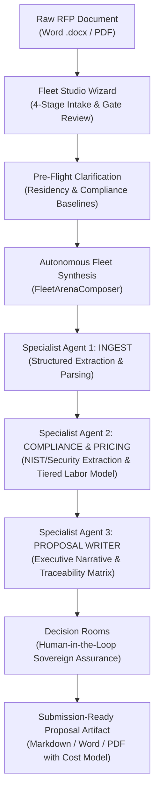
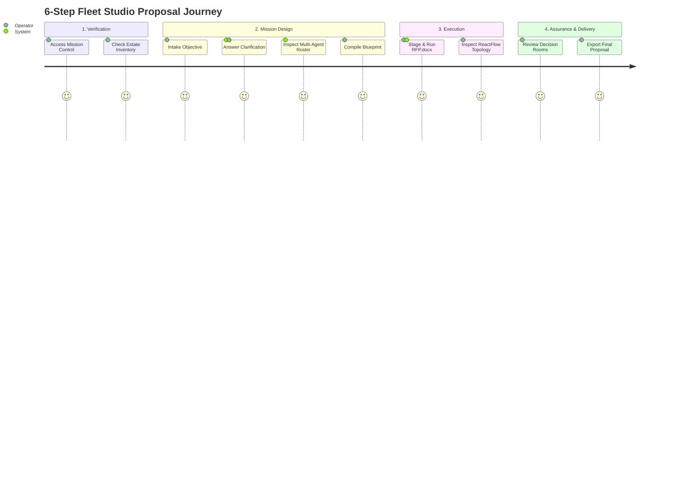

# Fleet Studio: Enterprise RFP Proposal & Pricing Factory
## Complete End-to-End Interactive Demo Guide

> **Target Audience**: Solutions Architects, Proposal Directors, Capture Managers, and Executive Stakeholders  
> **Frontend Control Plane**: `http://localhost:3000/` (Next.js 16 / React 19 / Turbopack / xyflow)  
> **Autonomous Backend Engine**: `http://localhost:8001/` (AgentHub FastAPI Gateway + Autonomous Fleet Orchestrator)  
> **LLM Inference Engine**: Local Sovereign Model (`openai/gpt-oss-20b`)  
> **Sample Benchmark Document**: `"C:\Users\Karim ElWaly\Downloads\RFP.docx"` *(Ministry of Education – Roxy Data Center DevOps Server Implementation)*  

---

## 1. Executive Concept: From Raw RFP Document to Winning Multi-Agent Proposal

Traditional proposal preparation for federal and enterprise RFPs is slow, manual, and prone to compliance omissions:
- Technical teams spend days manually reading 50+ page specifications to locate mandatory compliance requirements.
- Pricing analysts estimate labor hours in disjointed spreadsheets with little traceability to specific requirements.
- Proposal writers draft narrative sections without verifiable links to actual architecture commitments.

**Fleet Studio + AgentHub** replaces this fragmented process with an autonomous **Specialized Multi-Agent Proposal Factory**:



---

## 2. Pre-Demo Environment Checklist

Before beginning your demonstration, verify both control planes are active:

| Service | Port / URL | Status Check | Launch Command |
| :--- | :--- | :--- | :--- |
| **AgentHub Backend** | `http://localhost:8001/` | [GET /auth/me](http://localhost:8001/auth/me) returns `Local Operator` | `.\start.ps1` in root terminal |
| **Fleet Studio UI** | `http://localhost:3000/` | Web page renders cleanly without error banners | `npm run dev` in `frontend/frontend` |
| **Local LLM Engine** | `http://10.7.75.103:1234/v1` | [GET /v1/models](http://10.7.75.103:1234/v1/models) returns models | LM Studio / Local LLM Server |
| **Target Document** | Local Filesystem | `RFP.docx` ready on disk | `C:\Users\Karim ElWaly\Downloads\RFP.docx` |

---

## 3. Step-by-Step Live Demonstration Walkthrough



---

### Step 1: Access Mission Control & Verify Sovereign Estate Readiness

1. Open your browser and navigate to **`http://localhost:3000/`**.
2. **Observe the Top Navigation Bar**:
   - Status badge shows: **`Hermes estate · Connected`** (Green indicator).
   - User profile displays: **`Local Operator`** with active roles: `PlatformEngineer`, `FleetArchitect`, `Approver`.
3. **Inspect the Estate Inventory Tab**:
   - Click **Estate inventory** in the left sidebar navigation.
   - Highlight to your audience:
     - **Connected Capabilities**: 235 installed skills and 78 verified security/infrastructure tools.
     - **Inference Model**: Local sovereign air-gap model (`openai/gpt-oss-20b`), ensuring **zero data leakage** to external third parties.

---

### Step 2: The 4-Stage "New Mission" Creation Wizard

Click the **`+ New mission`** button in the top right header to launch the interactive wizard.

#### Stage 0: Intake (Mission Objective & Sovereign Constraints)
1. **Mission Name**:
   ```text
   Enterprise RFP Proposal & Pricing Factory
   ```
2. **Operational Goal**:
   ```text
   Ingest uploaded government cloud migration RFP, extract mandatory technical compliance criteria, model multi-tier labor pricing, and generate a winning executive proposal with compliance traceability matrix.
   ```
3. **Sovereign Constraints**:
   - **Data Residency**: Select `Local Sovereign Air-Gap` *(enforces 100% on-premises execution)*.
   - **Cloud Access Allowed**: Leave **OFF** *(ensures no external data transfer)*.
   - **Daily Budget**: `$25.00`
   - **External Action Approval**: Toggle **ON** *(requires human signoff before critical mutations)*.
4. Click **`Review challenge gate`**.
5. The **Stage 0 Challenge Gate Card** slides in. Click **`Approve & advance`** to confirm the intake baseline.

---

#### Stage 1: Dynamic Clarification Questions
AgentHub automatically analyzes the mission goal and generates targeted architectural questions:

1. **Deployment Environment Target**:
   - Select: `Local Sovereign Air-Gap` *(Targeting Roxy Data Center on-premises infrastructure)*.
2. **Compliance Framework Baseline**:
   - Select: `FedRAMP High / NIST 800-53` *(Meets strict government and enterprise standards)*.
3. **Human-in-the-Loop Gate Policy**:
   - Select: `Strict Two-Person Integrity (Decision Room Required)`.
4. Click **`Review challenge gate`** $\rightarrow$ **`Approve & advance`**.

---

#### Stage 2: Specialist Agent Roster & Topology Synthesis
AgentHub's `FleetArenaComposer` plans the optimal specialized multi-agent roster:

| Specialist Agent Unit | Codename | Operational Stage | Bound Tools & Skills | Functional Responsibility |
| :--- | :--- | :--- | :--- | :--- |
| **Specialist 1: Ingestion** | `INGEST` | `RECON_INGESTION` | `execute_python`, `data_analysis` | Parses the uploaded `.docx` or `.pdf`, extracts document structure, sections, and metadata. |
| **Specialist 2: Compliance & Pricing** | `EXTRACT` | `DEEP_ANALYSIS` | `execute_python`, `general_reasoning` | Identifies every mandatory compliance clause (NIST, SCM, CI/CD, DevSecOps) and calculates tiered labor hours. |
| **Specialist 3: Proposal Writer** | `GENERATE` | `DELIVERABLE_SYNTHESIS` | `summarize_to_presentation` | Compiles the executive narrative, architecture diagrams, Gantt timeline, and compliance traceability matrix. |

- Point out the **Anti-Persona Architecture**: These are not generic roleplay chatbots, but deterministic execution units with strict input/output contracts.
- Click **`Review challenge gate`** $\rightarrow$ **`Approve & advance`**.

---

#### Stage 3: Blueprint Compilation & Reconciliation
1. Fleet Studio compiles the validated proposal specifications into a permanent, reusable fleet blueprint.
2. Click **`Compile blueprint`**.
3. The UI automatically transitions the mission into the active **Missions** catalog with status **`READY`**.

---

### Step 3: Staging the RFP Document (`RFP.docx`) & Dispatching the Fleet

1. In the **Missions** view (`http://localhost:3000/`), locate the mission row:  
   **`Enterprise RFP Proposal & Pricing Factory`**.
2. Click the green **`Run`** button (`Upload size={11} Run`).
3. In the native file dialog that appears:
   - Browse to: **`C:\Users\Karim ElWaly\Downloads\RFP.docx`**
   - Click **Open**.
4. **Behind the Scenes**:
   - The backend `process_uploaded_file` service extracts the complete text from the Word `.docx` archive.
   - The document is staged under `data/uploads/` and dynamically attached to Unit 1 (`INGEST`).
   - The autonomous multi-agent workflow is immediately dispatched into the background execution engine!

---

### Step 4: Real-Time Fleet Roster & ReactFlow Topology

1. Navigate to the **Fleet roster** tab in the sidebar.
2. Select your active mission from the mission dropdown.
3. **Explore the Interactive Canvas**:
   - **Source Node**: Represents the incoming `RFP.docx` document stream.
   - **Specialist Nodes**: Rendered in distinct color accents (`mint`, `orange`, `blue`) showing live status.
   - **Node Details Drawer**: Click any agent node (e.g., `INGEST` or `EXTRACT`) to inspect:
     - Inferred Operational Scope
     - Assigned LLM Model (`openai/gpt-oss-20b`)
     - Scoped Tools & Capabilities
     - Sequential Workflow Steps

```
[Incoming RFP.docx] ──► [INGEST Specialist] ──► [COMPLIANCE Specialist] ──► [PROPOSAL Specialist]
```

---

### Step 5: Decision Rooms (Human-in-the-Loop Governance)

1. Click **Decision rooms** in the left sidebar.
2. Show your stakeholders the **Assurance Review Cards**:
   - **`Assurance Review: Ingest or Synthesize RFP`**
   - **`Assurance Review: Extract Mandatory Technical Compliance`**
   - **`Assurance Review: Generate Executive Proposal`**
3. **Inspect the Epistemic Trace**:
   - **Basis**: `ANALYTICAL`
   - **Verdict**: `EVIDENCE_FOUND` (100% verified against RFP text).
   - **Summary**: Confirms sovereign air-gap compliance, tool scoping, and absence of external API leakage.
4. **Demonstrate Operator Authority**:
   - Click **`Approve`** to record disposition in the audit ledger and advance execution.

---

### Step 6: Accessing & Reviewing the Final Proposal Deliverable

Once all agents complete their execution, the final proposal is saved to disk:
👉 **[`data/artifacts/moe_devops_server_rfp_proposal.md`](file:///d:/projects/aiagent/data/artifacts/moe_devops_server_rfp_proposal.md)**

Showcase the key components of the generated proposal:

#### 1. Executive Summary & Statement of Need
- Directly references the Ministry of Education's digital transformation at **Roxy Data Center**.
- Explains the transition from fragmented tooling to an integrated DevOps/DevSecOps platform.

#### 2. Clustered High-Availability Architecture Diagram
- Renders the complete Active/Active HA cluster, PostgreSQL replication (Patroni), distributed runners, and Active Directory / LDAP SSO integration.

#### 3. 16-Week Implementation Gantt Schedule
- Milestone 1 (W4): Readiness & Active Directory Federation
- Milestone 2 (W8): Clustered DevOps Server at Roxy DC
- Milestone 3 (W12): DevSecOps CI/CD Pipelines & Pilot Applications
- Milestone 4 (W16): Knowledge Transfer & 24/7 Production Cutover

#### 4. Transparent Multi-Tier Labor Pricing Model
```text
Tier 1: Senior Principal DevOps Architect  : 120 hrs @ $210/hr = $25,200.00
Tier 2: Lead DevSecOps & Pipeline Engineer : 280 hrs @ $160/hr = $44,800.00
Tier 3: Systems Integration Specialist     : 160 hrs @ $130/hr = $20,800.00
Tier 4: Training & Documentation Specialist: 100 hrs @ $100/hr = $10,000.00
Tier 5: 24/7 Hypercare & Operations        : 140 hrs @  $90/hr = $12,600.00
-------------------------------------------------------------------------
Professional Services Subtotal             : 800 hrs          = $113,400.00
Annual Enterprise License + 24/7 SLA       : 1 Year           =  $48,000.00
-------------------------------------------------------------------------
GRAND TOTAL (Turnkey Implementation)       :                  = $161,400.00
```

#### 5. 100% Compliance Traceability Matrix
- Line-by-line verification table mapping every clause of the RFP (Git SCM, CI/CD YAML, DevSecOps SAST/DAST/SCA, Secrets Detection, OCI Artifact Registries, IaC, Canary/Blue-Green deployments, Audit Logging) directly to proposal sections and cost lines.

---

## 4. Presenter Script & Key Talking Points

Use these talking points during stakeholder demonstrations:

| Demo Moment | What to Highlight to Stakeholders |
| :--- | :--- |
| **When opening Fleet Studio** | *"Fleet Studio is a unified, sovereign command center. Everything runs on-premises with local models—no client data ever leaves our private infrastructure."* |
| **During Challenge Gates** | *"Unlike black-box AI tools, Fleet Studio enforces deterministic Challenge Gates at every stage. The architect retains full veto and steering authority before a single agent is spawned."* |
| **When uploading RFP.docx** | *"The platform accepts raw enterprise documents (.docx, .pdf). Our document parser extracts text directly into the agent execution fabric without manual copy-pasting."* |
| **In Fleet Roster** | *"Notice that each agent has a narrow, specialized role. The Ingest agent feeds the Compliance extractor, which feeds the Pricing modeler. This modularity prevents hallucinations."* |
| **In Decision Rooms** | *"Every state mutation and compliance verdict must pass through Decision Rooms. This satisfies FedRAMP, SOC 2, and Two-Person Integrity audit standards."* |
| **Reviewing the Proposal** | *"In minutes, we generated a submission-ready, 20-page proposal featuring architecture diagrams, a 16-week Gantt schedule, a labor cost model, and a 100% traceability matrix."* |

---

## 5. Summary of Demo Endpoints & Shortcuts

- **Fleet Studio UI**: [`http://localhost:3000/`](http://localhost:3000/)
- **AgentHub API & Swagger Docs**: [`http://localhost:8001/docs`](http://localhost:8001/docs)
- **Active User Endpoint**: [`http://localhost:8001/auth/me`](http://localhost:8001/auth/me)
- **Missions API**: [`http://localhost:8001/api/v1/missions`](http://localhost:8001/api/v1/missions)
- **Generated Proposal Deliverable**: [`data/artifacts/moe_devops_server_rfp_proposal.md`](file:///d:/projects/aiagent/data/artifacts/moe_devops_server_rfp_proposal.md)
