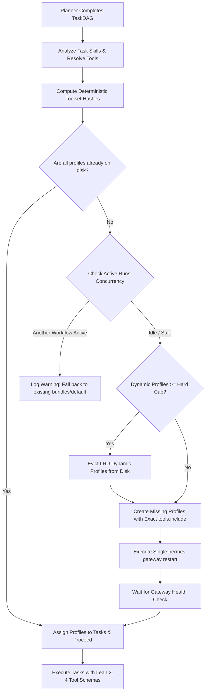

# Implementation Plan: Dynamic Bespoke Hermes Profiles with LRU Capacity Capping

## Overview
Currently, UAOS maps tasks without an agent to coarse, pre-provisioned tool bundles (`aiagent-bundle-*`) or falls back to `aiagent-default` (25+ tools) to avoid restarting the Hermes Gateway mid-workflow. 

This implementation plan introduces **Dynamic Bespoke Toolset Profiles**:
1. Following the planning phase, the system analyzes the exact tools required by each task in the generated `TaskDAG`.
2. Tasks are assigned deterministic, hashed profile names (`aiagent-dyn-<tool_hash>`).
3. If new profiles are needed, a strict **LRU (Least Recently Used) Eviction Manager** ensures the total number of dynamic profiles on disk never exceeds a hard cap (e.g., 15).
4. The Hermes Gateway is restarted **exactly once** before execution begins (masked during the workflow plan review window or between planning and execution).
5. If all profiles already exist, the restart is skipped entirely (0ms latency penalty).

---

## Architectural Flow



---

## Phase 1: Configuration & Settings

Extend [`src/core/config.py`](file:///d:/projects/aiagent/src/core/config.py) to declare capacity, timeout, and behavior controls.

### Add to `Settings`:
- `hermes_dynamic_profiles: bool = True`: Master toggle to enable dynamic bespoke profiles (falls back to static bundles if `False`).
- `hermes_max_dynamic_profiles: int = 15`: Hard cap on the total number of dynamic profiles permitted on disk.
- `hermes_gateway_restart_timeout_seconds: int = 25`: Maximum time to wait for the Hermes gateway to respond healthy post-restart.
- `hermes_profile_prefix_dynamic: str = "aiagent-dyn-"`: Prefix to distinguish dynamic profiles from permanent agent or system profiles.

---

## Phase 2: Profile State & LRU Eviction Engine

Enhance [`src/hermes/profiles.py`](file:///d:/projects/aiagent/src/hermes/profiles.py) with lifecycle tracking and cleanup.

### 1. Enhanced `ProfileState` Metadata (`data/hermes/profiles.json`)
Every dynamic profile entry stores:
```json
{
  "aiagent-dyn-9f4a1c2b": {
    "is_dynamic": true,
    "tools": ["read_file", "list_directory"],
    "created_at": 1791932000.0,
    "last_used_at": 1791932150.0,
    "token_sha256": "...",
    "mcp_url": "http://127.0.0.1:8000/mcp/"
  }
}
```

### 2. Touch Tracker
- Add `touch_profile(name: str)`: Updates `last_used_at = time.time()` whenever a task executes on that profile.

### 3. LRU Eviction Function
- `evict_lru_dynamic_profiles(needed_slots: int, max_dynamic: int, active_profiles: set[str]) -> list[str]`:
  1. Identify all dynamic profiles starting with `aiagent-dyn-` (excluding permanent profiles like `aiagent-default`, `aiagent-orchestrator`, or curated user agents).
  2. Filter out any profiles currently marked in `active_profiles` (from [`ActiveRuns`](file:///d:/projects/aiagent/src/hermes/active_runs.py)).
  3. Sort candidate profiles by `last_used_at` ascending (oldest first).
  4. Evict the oldest `k` profiles until `current_dynamic_count + needed_slots <= max_dynamic`.
  5. Eviction steps per profile:
     - Delete directory `~/.hermes/profiles/<name>`.
     - Delete skills directory `data/hermes/skills/<name>`.
     - Remove entry from `profiles.json`.

---

## Phase 3: DAG Profile Provisioning & Gateway Synchronization

Implement the core provisioning logic in [`src/hermes/provision.py`](file:///d:/projects/aiagent/src/hermes/provision.py).

### Key Function: `provision_dag_profiles(dag: TaskDAG | dict, registry: ToolRegistry, settings: Settings) -> tuple[dict, bool]`

1. **Toolset Deduplication:**
   - Iterate over tasks in the DAG.
   - For tasks without an explicit user agent:
     - Resolve `task.required_skills` to concrete `ToolSpec` objects.
     - Sort tool names: `tools_key = ",".join(sorted(t.name for t in tools))`.
     - Compute hash: `h = hashlib.sha256(tools_key.encode()).hexdigest()[:8]`.
     - Name: `aiagent-dyn-{h}` (or fallback to `aiagent-orchestrator` if tools are empty).
     - Store on task: `task["hermes_profile"] = profile_name`.

2. **Capacity & Eviction Check:**
   - Group newly needed profiles that do not currently exist on disk.
   - If `new_needed_count > 0`:
     - Inspect `current_dynamic_count`.
     - If `current_dynamic_count + new_needed_count > settings.hermes_max_dynamic_profiles`:
       - Trigger `evict_lru_dynamic_profiles(...)`.

3. **Concurrency-Safe Gateway Restart:**
   - If `new_needed_count > 0` or profiles were evicted:
     - Check `active_runs.any_active(quiet_seconds=10)`.
     - If another workflow is active:
       - **Safety Fallback:** Do NOT restart gateway. Leave task profile mapped to existing bundle or `aiagent-default` so running tasks are not dropped.
     - If idle:
       - Create new profile configs with `mcp_servers.aiagent.tools.include = tools`.
       - Execute `profiles.restart_gateway()`.
       - Await `client.healthy(timeout=settings.hermes_gateway_restart_timeout_seconds)`.

---

## Phase 4: Workflow & Activity Pipeline Wiring

### 1. New Activity in [`src/orchestrator/activities.py`](file:///d:/projects/aiagent/src/orchestrator/activities.py)
```python
@activity.defn
async def prepare_dag_profiles(dag_dict: dict) -> dict:
    """Provisions bespoke dynamic profiles and synchronizes the Hermes gateway."""
    registry = _get_registry()
    settings = get_settings()
    if not settings.hermes_dynamic_profiles or settings.worker_engine != "hermes":
        return dag_dict
    
    updated_dag, restarted = await asyncio.to_thread(
        provision_dag_profiles, dag_dict, registry, settings
    )
    return updated_dag
```

### 2. Temporal Workflow Integration in [`src/orchestrator/workflow.py`](file:///d:/projects/aiagent/src/orchestrator/workflow.py)
Place the activity immediately between planning and execution:
```python
# Phase 1: Plan
dag_dict = await workflow.execute_activity(plan_tasks, ...)

# Phase 1.5: Prepare Bespoke Hermes Profiles (One-time Gateway Sync)
dag_dict = await workflow.execute_activity(
    prepare_dag_profiles,
    args=[dag_dict],
    start_to_close_timeout=timedelta(seconds=60),
    retry_policy=RetryPolicy(maximum_attempts=2),
)

# Optional Human Review / Approval Pause here (gateway restart is already finished)
# Phase 2: Execute DAG
```

### 3. Direct API Integration in [`src/api/main.py`](file:///d:/projects/aiagent/src/api/main.py)
Mirror the same call after `plan_tasks` in the standalone `/runs` route:
```python
dag_dict = await plan_tasks(user_query, agent_id)
if settings.hermes_dynamic_profiles and settings.worker_engine == "hermes":
    dag_dict = await prepare_dag_profiles(dag_dict)
```

---

## Phase 5: Hermes Worker Agent Integration

Update [`src/workers/hermes_agent_worker.py`](file:///d:/projects/aiagent/src/workers/hermes_agent_worker.py):
- Currently, `_ready_bundle()` inspects hardcoded bundles.
- Update `execute()`:
  - If `task.hermes_profile` or `task_dict.get("_hermes_profile")` is populated with an `aiagent-dyn-*` profile:
    - Use that profile directly.
    - Call `profiles.state.touch_profile(profile_name)`.
  - Skip bundle selection when a bespoke profile is already assigned.

---

## Phase 6: Edge Case Guardrails

| Risk / Edge Case | Failure Mode | Mitigation in this Plan |
| :--- | :--- | :--- |
| **Profile Disk Explosion** | Hundreds of folders in `~/.hermes/profiles/` slow down gateway boot. | Hard cap enforced via LRU eviction (`MAX_DYNAMIC_PROFILES = 15`). |
| **Dropping Parallel Workflows** | Workflow A is executing; Workflow B restarts gateway. | `ActiveRuns.any_active()` check. If busy, Workflow B skips restart and falls back to static bundles. |
| **Re-planning Mid-Workflow** | Task fails, triggering `replan_tasks`. | Re-planning skips dynamic restarts and uses existing profiles to protect in-flight state. |
| **Gateway Boot Hang** | Hermes CLI hangs during restart. | Subprocess timeout (20s) and health probe backoff with automatic recovery. |
| **Permanent Profile Deletion** | Accidental eviction of `aiagent-orchestrator` or user agents. | Strict prefix validation: only profiles matching `aiagent-dyn-` are eligible for eviction. |

---

## Phase 7: Verification & Testing Plan

1. **Unit Tests (`tests/unit/test_dynamic_profiles.py`):**
   - Test toolset hash determinism: identical toolsets produce identical profile names.
   - Test LRU eviction: when adding the 16th profile against a cap of 15, verify the least recently used profile is purged from disk and JSON.
   - Verify protected profiles (`aiagent-default`, `aiagent-orchestrator`, user agents) are never evicted.
   - Test no-op restart: when all required profiles exist, verify `restart_gateway` is not called.
   - Test active run protection: verify restart is aborted if `ActiveRuns.any_active()` is True.

2. **Integration Verification:**
   - Execute a multi-phase case (e.g., SOC Alert Investigation).
   - Verify each task runs on its bespoke `aiagent-dyn-*` profile with only 2–4 tools.
   - Verify LM Studio / model server logs show lean `tools: [...]` arrays without prompt bloat.
   - Verify single gateway restart occurs during the planning transition.
